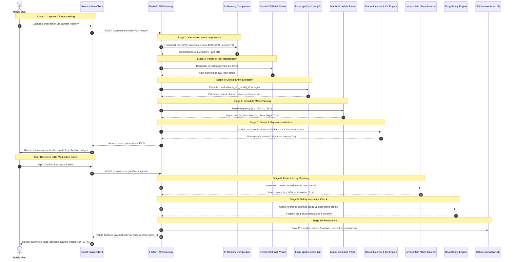
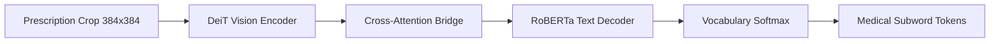

# MediScan - Prescription Digitization & Clinical Intelligence System
**Comprehensive Engineering Documentation & Architectural Blueprint**
*Final Year Computer Science Engineering Capstone Project | Srinivas Institute of Technology*

---

## 1. Executive Summary & Project Overview

### 1.1 Problem Statement
Handwritten medical prescriptions remain the primary medium of clinical communication across outpatient facilities and hospitals globally, especially in developing regions. However, handwritten clinical notes suffer from severe limitations:
- **Illegibility & Medical Errors:** Poor handwriting leads to dispensing errors, incorrect dosages, and adverse drug events (ADEs), which represent a major preventable cause of patient injury worldwide.
- **Fragmented Patient History:** Paper prescriptions are frequently lost, torn, or misplaced by patients, leading to zero continuity of care during subsequent clinical visits.
- **Undetected Drug-Drug Interactions (DDIs):** Patients consulting multiple specialists often receive overlapping or contraindicated medications without any cross-verification against their ongoing chronic therapies.
- **Fraudulent & Unregistered Prescriptions:** Unlicensed practitioners or counterfeit slips lacking valid state medical council registration numbers and signatures pass through pharmacies unverified.
- **Language & Literacy Barriers:** Patients from non-English speaking backgrounds struggle to comprehend dosage schedules (e.g., abbreviations like *TDS*, *HS*, *1-0-1*), causing poor treatment adherence.

### 1.2 System Objectives & Core Value Proposition
**MediScan** (also branded as **PrescriptoAI**) is an end-to-end mobile and cloud-assisted clinical intelligence platform designed to digitize, normalize, verify, and monitor medical prescriptions. 

The core value propositions of the platform include:
1. **Hybrid Vision OCR & Clinical NLP Pipeline:** Rapid multi-stage transcription using optimized Gemini 3.5 Flash vision endpoints coupled with a fine-tuned local clinical spaCy model (`clinical_nlp_model_v2`) and local regex parsing heuristics.
2. **Deterministic Dosage Matrix Parsing:** Dynamic translation of numeric dose matrices (e.g., `1-0-1`, `0-1-0`, `1-1-1`) and Latin abbreviations (`OD`, `BD`, `TDS`, `HS`) into automated morning, afternoon, and night alarm notifications.
3. **Automated Clinical Verification Engine:** Doctor registration number lookup against a SQLite registry of authorized practitioners alongside OpenCV computer vision contour analysis to verify physician signatures.
4. **Patient Fuzzy Identity Matching:** Levenshtein token sort ratio algorithms (`thefuzz`) matching scanned prescription patient names with the registered device owner to detect whether prescriptions belong to the logged-in user.
5. **Cross-Referenced Drug Safety Alerts:** Automated pairwise screening between newly prescribed medications and existing patient active profiles against an indexed clinical interaction database (`interactions.csv` and DDInter schemas).
6. **Accessibility & Regional Inclusivity:** Integrated multi-lingual Text-to-Speech (TTS) engine delivering localized dosage instructions in English, Hindi, and Kannada, alongside instant high-fidelity clinical PDF report generation.

### 1.3 High-Level System Architecture
The MediScan ecosystem is structured around a decoupled client-server paradigm optimized for low-latency edge performance and high computational reliability:

```mermaid
graph TD
    subgraph Client ["Mobile Client (React Native / Expo SDK 57)"]
        Cam[Camera / Gallery Capture] --> Pre[Client-Side Preprocessing]
        Pre --> Upload[HTTP Multi-Part Upload]
        Cards[Interactive Medication Cards] --> Finalize[Finalize & Safety Request]
        TTS[Voice Assistant / TTS Engine]
        PDF[PDF Report Generator]
        Alarms[AsyncStorage Alarm Slots]
    end

    subgraph Backend ["Microservices Backend (FastAPI / Uvicorn :8000)"]
        Router[API Gateway & Router]
        Compressor[In-Memory JPEG Compressor (PIL)]
        Gemini[Gemini 3.5 Flash Vision OCR]
        NLP[spaCy Clinical NLP (v2/v4)]
        JSONFallback[Pydantic Structured JSON Fallback]
        ScheduleParser[Matrix Dosage Parser (1-0-1)]
        FuzzyMatcher[Levenshtein Patient Matcher (thefuzz)]
        DocVerify[Doctor Registry & CV Signature Detector]
        SafetyEngine[Drug-Drug Interaction Engine]
    end

    subgraph Storage ["Persistent Data Layer"]
        SQLite[(SQLite: mediscan.db)]
        DDI_DB[(DDInter Reference Datasets)]
    end

    Upload --> Router
    Router --> Compressor
    Compressor --> Gemini
    Gemini --> NLP
    NLP -. Fallback if 0 meds .-> JSONFallback
    NLP --> ScheduleParser
    Router --> DocVerify
    DocVerify --> SQLite
    Finalize --> FuzzyMatcher
    FuzzyMatcher --> SafetyEngine
    SafetyEngine --> DDI_DB
    SafetyEngine --> SQLite
    SQLite --> Router
    Router --> Cards
```

---

## 2. Complete File Directory & Component Mapping

### 2.1 Workspace Directory Structure
```text
prescription-digitization-system-main/
│
├── backend/                                   # FastAPI REST Backend & AI Service Layer
│   ├── .env                                   # Active environment configuration (GEMINI_API_KEY)
│   ├── .env.example                           # Template environment configuration
│   ├── main.py                                # Backend entry point, CORS middleware, route bindings
│   ├── mediscan.db                            # SQLite database file for application state
│   ├── requirements.txt                       # Backend Python dependencies
│   ├── app/
│   │   ├── __init__.py                        # Package marker
│   │   ├── main.py                            # Forwarding module referencing backend/main.py
│   │   ├── api/                               # REST API Endpoints & Routers
│   │   │   ├── __init__.py
│   │   │   ├── routes.py                      # Core prescription routes (/extract, /finalize, /prescriptions)
│   │   │   ├── safety.py                      # Standalone drug interaction check route (/safety/check)
│   │   │   └── user.py                        # User profile management route (/user/profile)
│   │   ├── core/
│   │   │   └── __init__.py
│   │   └── services/                          # Business logic, OCR, NLP, and database services
│   │       ├── __init__.py
│   │       ├── safety_engine.py               # Pairwise DDI checker with generic name normalization
│   │       ├── verification_engine.py         # SQLite doctor license lookup service
│   │       ├── database/
│   │       │   ├── __init__.py
│   │       │   ├── db.py                      # SQLAlchemy engine, session maker, schema auto-migration
│   │       │   ├── mediscan.db                # Service-level SQLite database file
│   │       │   └── models.py                  # SQLAlchemy ORM models (Prescription, User, DDI, DoctorLicense)
│   │       ├── drug_interaction/
│   │       │   ├── __init__.py
│   │       │   ├── checker.py                 # File-based CSV fallback interaction checker
│   │       │   └── interactions.csv           # Seed interaction pair definitions
│   │       ├── image/
│   │       │   └── signature_detector.py      # OpenCV signature detection service (quadrant analysis)
│   │       ├── medicine/
│   │       │   ├── __init__.py
│   │       │   ├── extractor.py               # spaCy NER loader, regex list parser, dosage schedule matrix
│   │       │   ├── fuzzy_matcher.py           # RapidFuzz entity normalizer against standard formulary
│   │       │   └── gemini_parser.py           # Structured Pydantic JSON parser via Gemini API fallback
│   │       └── ocr/
│   │           ├── __init__.py
│   │           ├── ocr_engine.py              # Gemini 3.5 Flash client, prompt manager, retry strategy
│   │           └── signature_detector.py      # Dual-mode (bytes/path) OpenCV contour analyzer
│   ├── data/                                  # DDInter clinical drug interaction datasets
│   │   ├── db_drug_interactions.csv           # Consolidated interaction master dataset
│   │   ├── ddinter_downloads_code_A.csv       # Anatomical therapeutic category A interactions
│   │   ├── ddinter_downloads_code_B.csv       # Category B interactions (Blood / Blood forming)
│   │   ├── ddinter_downloads_code_D.csv       # Category D interactions (Dermatologicals)
│   │   ├── ddinter_downloads_code_H.csv       # Category H interactions (Systemic hormones)
│   │   └── ddinter_downloads_code_L.csv       # Category L interactions (Antineoplastics)
│   ├── scripts/                               # Database provisioning and population scripts
│   │   ├── init_db.py                         # Table creation and schema inspection script
│   │   ├── seed_ddi_db.py                     # Populates drug_interactions table from CSV datasets
│   │   └── seed_doctors_db.py                 # Seeds registered practitioner licenses into SQLite
│   └── temp_uploads/                          # In-memory and transient staging folder for upload payloads
│
├── frontend/                                  # Mobile Client Application (React Native / Expo)
│   ├── .env                                   # Local client environment (EXPO_PUBLIC_API_URL)
│   ├── .env.example                           # Frontend environment variables template
│   ├── App.js                                 # Root component, SafeAreaProvider, AuthProvider wrap
│   ├── app.json                               # Expo project manifest, orientation, permissions
│   ├── index.js                               # Expo registerRootComponent bootstrap
│   ├── package.json                           # React Native, Expo, and UI library dependencies
│   ├── scripts/
│   │   └── start-dev.js                       # Auto-detects active LAN IPv4 address for zero-config demo
│   └── src/
│       ├── constants/
│       │   ├── config.js                      # Configures API_BASE_URL (dynamic IP or LAN fallback)
│       │   └── theme.js                       # Material Design 3 color palette, typography, shadows
│       ├── context/
│       │   └── AuthContext.js                 # Global React context for user state and auto-medication sync
│       ├── navigation/
│       │   └── AppNavigator.js                # AuthStack vs MainTabs stack, tab routing, loading splash
│       ├── screens/
│       │   ├── DashboardScreen.js             # Overview screen with recent scans, quick upload, greetings
│       │   ├── HistoryScreen.js               # Clinical timeline, pull-to-refresh, audio readout, PDF export
│       │   ├── HomeScreen.js                  # Landing dashboard fallback
│       │   ├── LoginScreen.js                 # Initial identity authentication screen
│       │   ├── OnboardingScreen.js            # Profile setup, chronic conditions, active medications
│       │   ├── PrescriptionDetailsScreen.js   # Detailed clinical analysis view, alarm modal, translation
│       │   ├── ProfileScreen.js               # User health profile, conditions, medications, alarm slots
│       │   ├── RecordsScreen.js               # Historical archive screen
│       │   └── UploadScreen.js                # Multi-stage image upload, interactive medication editor
│       └── services/
│           ├── alarmStorage.js                # AsyncStorage utility for custom morning/afternoon/night times
│           ├── notificationService.js         # Daily alarm slot parser, mock notifications for Expo Go
│           ├── pdfExportService.js            # Generates styled HTML clinical report and triggers Print/Share
│           ├── profileService.js              # Background sync saving detected medications to user profile
│           └── ttsService.js                  # Voice assistant TTS with English, Hindi, and Kannada support
│
├── ml_development/                            # Offline Machine Learning & Model Development Assets
│   ├── data/
│   │   ├── clinical_nlp_model_v2/             # Local fine-tuned spaCy NER model for clinical entity extraction
│   │   ├── clinical_nlp_model_v4/             # Iteration v4 of custom spaCy NER pipeline
│   │   ├── trocr_prescription_final/          # Fine-tuned TrOCR Vision-Encoder-Decoder model weights
│   │   ├── best_model/                        # Stage 1 PyTorch model checkpoint
│   │   ├── best_model_v2_final/               # Stage 2 refined PyTorch model checkpoint
│   │   ├── best_model_v3_final/               # Stage 3 PyTorch checkpoint
│   │   └── vocab/                             # Tokenizer vocabulary and word vectors
│   └── datasets/
│       └── labels/                            # Ground truth annotation schemas for training sets
│
├── research/                                  # R&D, Synthetic Generation, and Model Training Scripts
│   ├── aggregator.py                          # Compiles multi-source prescription training sets
│   ├── final_test.py                          # Standalone evaluation script for TrOCR inference
│   ├── generate_synthetic_v2.py               # Generates synthetic prescription slips for data augmentation
│   ├── get_vocab.py                           # Compiles medical dictionary tokens
│   ├── medical_terms.txt                      # 5,000+ clinical and pharmaceutical terminology glossary
│   ├── train.py                               # Hugging Face TrOCR fine-tuning script (Stage 1)
│   ├── train_refinement.py                    # Surgical refinement script with learning rate decay (Stage 2)
│   └── update_vocab.py                        # Updates tokenizer vocabulary matrices
│
├── context.md                                 # Operational history, bug resolutions, and system status
├── PROJECT_DOCUMENTATION.md                   # Complete architectural and technical reference (this file)
└── README.md                                  # Quick-start developer setup guide
```

---

### 2.2 File-by-File Technical Audit

#### 2.2.1 Backend Core & API Layer

##### `backend/main.py`
- **Purpose:** Entry point for the FastAPI application. Sets up lifespan events, CORS policies, and mounts all modular API routers with extensive route aliases.
- **Key Components:**
  - `lifespan(app: FastAPI)`: Async context manager executed on Uvicorn startup. Invokes `init_db()` to verify that SQLite tables and columns exist before accepting connections.
  - `CORSMiddleware`: Permits all origins (`*`), headers, and methods to enable React Native mobile clients and web debuggers to communicate without cross-origin blocking.
  - `app.include_router(...)`: Mounts `user_router`, `safety_router`, and `prescription_router` across multiple prefixes (`/api/scan`, `/api/v1/scan`, `/scan`, `/api/prescriptions`, `/api/v1/prescriptions`, `/user`, `/safety`).
  - `health_check()`: Root GET `/` health probe returning JSON `{"status": "healthy", "service": "PrescriptoAI"}`.

##### `backend/app/main.py`
- **Purpose:** Forwarding module that imports `app` from `backend/main.py`. Ensures seamless operation whether Uvicorn is launched from repository root or inside `backend/app`.

##### `backend/app/api/routes.py`
- **Purpose:** Primary REST controller orchestrating prescription extraction, client verification, clinical finalization, history retrieval, and user profile endpoints.
- **Key Endpoints & Functions:**
  - `extract_prescription(file: UploadFile = File(...))`: Handled at `@router.post("/extract")`, `/scan/extract`, `/scan`. Validates file MIME types, saves a transient copy in `temp_uploads`, executes in-memory LANCZOS downscaling to 1024px and JPEG compression (quality 70), invokes `OCREngine.extract_text()`, calls `verify_license()` and `detect_signature()`, recalculates active schedule slots, and returns a structured payload.
  - `finalize_prescription(payload: Dict[str, Any] = Body(...), db: Session = Depends(get_db))`: Handled at `@router.post("/finalize")`, `/scan/finalize`, `/api/v1/scan/finalize`. Normalizes medication card inputs, extracts the scanned patient name, computes Levenshtein fuzzy match score against the registered user via `fuzz.token_sort_ratio`, triggers pairwise `check_interactions()`, updates user active medications if verified, and persists a `Prescription` record into SQLite.
  - `get_prescriptions(db: Session = Depends(get_db))`: Handled at `@router.get("/prescriptions")`, `/api/v1/prescriptions`. Queries all stored prescriptions ordered descending by date and reconstructs parsed payloads with fallback decoding.
  - `get_user_profile(db: Session = Depends(get_db))`: Handled at `@router.get("/user/profile")`. Defensive endpoint returning multi-schema structures (both structured objects and raw string arrays) along with aggregate prescription counts to prevent mobile client runtime crashes.

##### `backend/app/api/safety.py`
- **Purpose:** Standalone API router dedicated to on-demand safety checks and drug-drug interaction screening.
- **Key Components:**
  - `SafetyCheckRequest`: Pydantic schema supporting both `scanned_drugs` and optional `profile_drugs` as lists of strings or medication dictionaries.
  - `SafetyCheckResponse`: Pydantic model returning interaction pairs, total interaction count, and status.
  - `run_safety_check(payload: SafetyCheckRequest, db: Session = Depends(get_db))`: Endpoint at POST `/check`. If `profile_drugs` is omitted, automatically fetches the active medications of the primary registered user from SQLite.

##### `backend/app/api/user.py`
- **Purpose:** API router dedicated to managing user demographic profiles, current medical conditions, and chronic medications.
- **Key Components:**
  - `serialize_to_json_string(value)`: Defensive serializer converting raw string lists, comma-separated strings, or JSON strings into standard JSON arrays for database storage.
  - `deserialize_json_string(value)`: Deserializer converting stored JSON strings back into clean Python string lists.
  - `save_user_profile(payload: UserProfileRequest, db: Session = Depends(get_db))`: Endpoint at POST `/profile`. Upserts user record with sanitized demographic and medical arrays.

#### 2.2.2 Backend Data Services & Persistence Layer

##### `backend/app/services/database/db.py`
- **Purpose:** Database engine initialization and session lifecycle management using SQLAlchemy.
- **Key Components:**
  - `DATABASE_URL`: Resolves `sqlite:///.../mediscan.db` using absolute filesystem paths.
  - `engine`: Created with `connect_args={"check_same_thread": False}` to allow multi-threaded access from asynchronous FastAPI route handlers.
  - `init_db()`: Calls `Base.metadata.create_all()` and inspects existing table columns. Performs dynamic `ALTER TABLE` migrations for legacy SQLite files lacking columns (`user_id`, `scanned_patient_name`, `extracted_data`, `date_scanned`, `filename`, `extracted_text`, `created_at`).
  - `get_db()`: FastAPI dependency yielding database sessions and guaranteeing safe session teardown (`db.close()`).

##### `backend/app/services/database/models.py`
- **Purpose:** SQLAlchemy declarative ORM model definitions.
- **Key Models:**
  - `Prescription`: Maps to `prescriptions` table. Attributes: `id` (PK, Integer), `user_id` (Indexed Integer), `scanned_patient_name` (Text), `extracted_data` (Text JSON), `date_scanned` (DateTime), `filename` (String), `extracted_text` (Text), `created_at` (DateTime).
  - `User`: Maps to `users` table. Attributes: `id` (PK), `name` (Text), `email` (Text), `phone` (Text), `current_conditions` (Text JSON), `active_medications` (Text JSON).
  - `DrugInteraction`: Maps to `drug_interactions` table. Attributes: `id` (PK), `drug_1` (Indexed Text), `drug_2` (Indexed Text), `level` (Text), `interaction` (Text).
  - `DoctorLicense`: Maps to `doctor_licenses` table. Attributes: `id` (PK), `reg_no` (Unique Indexed Text), `doctor_name` (Text), `status` (Text: "Valid", "Suspended", "Invalid").

#### 2.2.3 Backend Clinical NLP, OCR & Verification Services

##### `backend/app/services/ocr/ocr_engine.py`
- **Purpose:** Vision OCR orchestration layer interfacing with Google Gemini 3.5 Flash endpoints.
- **Key Components:**
  - `MODELS_TO_TRY`: Priority fallback sequence configured for 2026 Gemini vision models: `["gemini-3.5-flash-lite", "gemini-3.5-flash"]`.
  - `transcribe_image_raw_text(image_path: str) -> str`: Loads the downscaled image via PIL, issues a strict zero-hallucination verbatim transcription prompt to the Gemini client (`genai.Client`), and retrieves raw handwritten and printed characters.
  - `extract_text(image_path: str) -> dict`: Executes raw transcription, pipes the text through `NLPExtractor.parse_prescription()`, checks if local entities were found, and if zero medicines were identified, automatically triggers the secondary fail-safe parser (`gemini_parser.py`).

##### `backend/app/services/medicine/extractor.py`
- **Purpose:** Primary local clinical entity extraction engine combining custom spaCy Named Entity Recognition (NER) with deterministic medical regex heuristics.
- **Key Components:**
  - `parse_dosage_schedule(text: str) -> dict`: Deterministic regex engine that detects:
    1. 3-slot matrices: `r'(\d+(?:/\d+)?|\d*\.\d+)\s*-\s*(\d+(?:/\d+)?|\d*\.\d+)\s*-\s*(\d+(?:/\d+)?|\d*\.\d+)'` matching inputs like `1-0-1`, `1 - 0 - 1`, `0.5-0-0.5`.
    2. Clinical shorthand codes: `BD`/`BID` (Morning & Night), `TDS`/`TID` (Morning, Afternoon, Night), `OD` (Morning), `HS` (Night).
    3. Returns `{"schedule_text": str, "schedule_slots": {"morning": bool, "afternoon": bool, "night": bool}}`.
  - `NLPExtractor`: Class that loads `clinical_nlp_model_v2` from disk.
    - Extracts `DISEASE`, `ADVICE`, `MEDICINE`, and `DOCTOR_ID` entity labels.
    - Applies regex heuristics to isolate Patient Name, Age, Sex, Physician Name, Registration Number, and Hospital/Clinic names.
    - Employs a structural line parser that splits text into prescription (`Rx`) segments, filters out non-medication boilerplate, identifies dosages (`500mg`, `10ml`), forms (`Tab`, `Cap`, `Syrup`), and packages the resulting data into normalized schemas.

##### `backend/app/services/medicine/gemini_parser.py`
- **Purpose:** Secondary fail-safe clinical extraction engine invoked when local spaCy or regex parsers return 0 medicines from valid transcription text.
- **Key Components:**
  - `Medicine(BaseModel)`: Pydantic schema enforcing clean generic drug name and plain-English dosage instructions.
  - `PrescriptionData(BaseModel)`: Pydantic schema enforcing doctor name, hospital name, patient name, age, license number, and medicine array.
  - `parse_ocr_text(raw_text_array)`: Calls `gemini-3.6-flash` with `response_mime_type="application/json"` and `response_schema=PrescriptionData` at temperature 0.0 to prevent hallucination.

##### `backend/app/services/medicine/fuzzy_matcher.py`
- **Purpose:** Token normalization engine utilizing RapidFuzz (`fuzz.WRatio`) to match noisy extracted drug names against an approved dictionary of 50+ common pharmaceutical formulations.

##### `backend/app/services/verification_engine.py`
- **Purpose:** Doctor license validation against the SQLite `doctor_licenses` registry.
- **Key Components:**
  - `verify_license(reg_no: Optional[str]) -> Dict[str, Any]`: Executes multi-stage matching:
    1. Exact case-insensitive match on `reg_no`.
    2. Stripped numeric digit match (e.g., matching `LIC-45872` to `45872`).
    3. Wildcard bidirectional substring match (`LIKE %...%`).
    4. Returns license status (`Valid`, `Suspended`, `Invalid`, or `Not Found`) and registered physician name.

##### `backend/app/services/safety_engine.py`
- **Purpose:** Clinical safety engine executing pairwise drug-drug interaction (DDI) checks.
- **Key Components:**
  - `clean_drug_name(name: str) -> str`: Normalizes drug names by stripping dosage strengths (e.g., `500mg`, `10 mg`, `2.5ml`), formulations (`tablet`, `capsule`, `syrup`), and non-alphanumeric punctuation.
  - `check_interactions(scanned_drugs, profile_drugs)`: Evaluates all Cartesian pairs:
    1. Between newly scanned drugs and the patient's existing active profile.
    2. Between multiple newly scanned drugs on the same prescription slip.
    - Queries `drug_interactions` table enforcing alphabetical ordering (`drug_1 <= drug_2`) with wildcard fallback matching. Returns severity level (`Major`, `Moderate`, `Minor`) and detailed pharmacological interaction warnings.

##### `backend/app/services/ocr/signature_detector.py` & `backend/app/services/image/signature_detector.py`
- **Purpose:** Computer vision service detecting doctor signatures using OpenCV contour analysis.
- **Key Components:**
  - `detect_signature(image_input) -> bool`:
    1. Supports in-memory byte buffers, file paths, or NumPy image arrays.
    2. Crops the bottom-right quadrant (y: 50%-100%, x: 45%-100%) and bottom wide strip.
    3. Converts to grayscale, applies Gaussian blur $(5 \times 5)$, and computes Otsu binary inverse thresholding.
    4. Applies horizontal morphological structuring elements (`MORPH_OPEN`) to subtract straight printed underlines and bounding boxes.
    5. Calculates contour area, bounding box aspect ratio, and perimeter-to-area stroke complexity ($perimeter^2 / area > 11.0$). Classifies freehand cursive strokes as valid doctor signatures.

#### 2.2.4 Frontend Mobile Components & Services

##### `frontend/App.js`
- **Purpose:** Root application component. Wraps the component tree with `SafeAreaProvider`, `AuthProvider`, and `NavigationContainer`. Configures the top status bar.

##### `frontend/src/navigation/AppNavigator.js`
- **Purpose:** Central navigation controller implementing conditional authentication routing and bottom tab navigation.
- **Key Components:**
  - `BottomTabs()`: Renders Material 3 style bottom tab bar with icons for `Home` (`DashboardScreen`), `Scan` (`UploadScreen`), `Records` (`HistoryScreen`), and `Profile` (`ProfileScreen`).
  - `AppNavigator()`: Renders `LoadingSplash` while profile is loading, `AuthStack` (`LoginScreen`, `OnboardingScreen`) if user profile is null, and `MainStack` (`BottomTabs`, `PrescriptionDetailsScreen`, `EditProfile`) once authenticated.

##### `frontend/src/context/AuthContext.js`
- **Purpose:** Global authentication and profile context provider.
- **Key Components:**
  - `user`: Holds current patient profile (name, email, current conditions, active medications).
  - `fetchProfile()`: Dispatches GET `/user/profile` on launch.
  - `saveProfile(profileData)`: Dispatches POST `/user/profile` to update user demographic and medical arrays.
  - `addMedicationToProfile(matchedDrugData)`: Delegates to `profileService` to asynchronously add newly identified drugs to the patient's active profile in the background.

##### `frontend/src/constants/config.js`
- **Purpose:** Resolves `API_BASE_URL` using `process.env.EXPO_PUBLIC_API_URL` or defaults to the host machine LAN IP (`http://10.109.122.170:8000`).

##### `frontend/src/constants/theme.js`
- **Purpose:** Complete Material Design 3 design system tokens defining clinical brand colors (`primary: #006684`, `secondary: #4b626d`, `tertiary: #5d5b7d`, `surface: #f8fafc`, `error: #ba1a1a`), semantic alert palettes, and elevation shadows.

##### `frontend/src/screens/UploadScreen.js`
- **Purpose:** Central clinical scanning interface.
- **Key Features:**
  - Image capture via `ImagePicker.launchCameraAsync` or gallery selection via `launchImageLibraryAsync`.
  - Multi-stage animated loading feedback (`LoadingStage`: OCR API -> NLP API -> Categorising -> Validating).
  - 120-second timeout controller with automatic fallback from `fetch(FormData)` to `FileSystem.uploadAsync`.
  - Interactive medication card editor allowing users to review, correct, delete, or add medications prior to finalization.
  - Finalize confirmation button triggering POST `/scan/finalize`.
  - Integrated utility actions: Regional TTS playback, alarm scheduling, and PDF report export.

##### `frontend/src/screens/PrescriptionDetailsScreen.js`
- **Purpose:** Deep clinical analysis view for completed or historical prescription scans.
- **Key Features:**
  - Doctor verification status banner showing valid/suspended registration status and signature presence.
  - Patient fuzzy match score indicator displaying ownership confidence.
  - Categorized medication cards with frequency badges, instructions, and interactive alarm slots.
  - Prominent Drug-Drug Interaction alert cards color-coded by severity (Major, Moderate, Minor).
  - Interactive alarm customizer modal allowing users to tweak morning, afternoon, and night reminder times.
  - Regional audio synthesis controls and clinical PDF generation triggers.

##### `frontend/src/screens/DashboardScreen.js`
- **Purpose:** Mobile home screen displaying patient health summary.
- **Key Features:**
  - Personalized time-aware greeting and profile shortcut.
  - Quick-action banner launching the prescription scanner.
  - Pull-to-refresh list of recent prescription scans with direct navigation to detailed inspection views.

##### `frontend/src/screens/HistoryScreen.js`
- **Purpose:** Historical prescription archive and timeline.
- **Key Features:**
  - Pull-to-refresh listing of all analyzed prescriptions from SQLite.
  - One-tap digital PDF export directly from the history card.
  - In-line Text-to-Speech audio toggle allowing users to listen to instructions without opening details.

##### `frontend/src/screens/ProfileScreen.js`
- **Purpose:** Patient health profile management interface.
- **Key Features:**
  - Renders user demographic details, chronic conditions, and active medications.
  - Defensive rendering logic supporting both structured medication objects and raw string lists.
  - Overview of configured daily alarm times (`getSavedUserAlarms()`) and session logout controls.

##### `frontend/src/services/ttsService.js`
- **Purpose:** Regional multi-lingual Text-to-Speech voice assistant service.
- **Key Components:**
  - `TTS_LANGUAGES`: Defines supported languages: English (`en-IN`), Hindi (`hi-IN`), and Kannada (`kn-IN`).
  - `formatForSpeech(text)`: Converts matrix strings like `1-0-1` into human phrases like *"take one in the morning and one at night"*.
  - `expandMedicalAbbreviations(text)`: Replaces abbreviations (`mg`, `tab`, `tds`) with spoken phonetics.
  - `translatePrescriptionText(text, targetLang)`: Attempts online neural translation via Google Translate GTX API with automatic fallback to an extensive offline dictionary of clinical phrases in Hindi and Kannada.
  - `speakMedication(med, options)` & `speakFullPrescription(data, options)`: Wrapper around `expo-speech` with rate, pitch, and completion listeners.

##### `frontend/src/services/pdfExportService.js`
- **Purpose:** Clinical PDF document generator.
- **Key Components:**
  - `generatePrescriptionHTML(data)`: Generates a high-resolution, responsive HTML/CSS clinical prescription template containing clinic headers, verification watermarks, doctor license badges, structured medication tables, physician advice, and safety interaction alerts.
  - `exportPrescriptionPDF(data)`: Renders HTML to a local PDF document via `expo-print.printToFileAsync` and triggers the OS native share sheet via `expo-sharing.shareAsync`.

##### `frontend/src/services/notificationService.js` & `frontend/src/services/alarmStorage.js`
- **Purpose:** Medication adherence alarm scheduler and local storage manager.
- **Key Components:**
  - `parseMedicationSlots(med)`: Converts dosage schedule text into active slot flags (`morning: bool`, `afternoon: bool`, `night: bool`).
  - `alarmStorage.js`: Persists user-defined preferred reminder times (defaulting to 8:00 AM, 1:00 PM, and 8:00 PM) in `AsyncStorage` and provides helpers to format 12-hour timestamps.

---

## 3. End-to-End Execution & Data Flow



### Detailed Step-by-Step Breakdown

#### Step 1: Image Capture & Client-Side Preprocessing
- The user triggers camera capture or selects an existing photo in `UploadScreen.js`.
- `expo-image-picker` generates a local filesystem URI (`file:///.../image.jpg`).
- The client initializes an `AbortController` with a 120-second timeout to accommodate low-bandwidth edge networks.
- A multi-part `FormData` payload containing the image stream is dispatched to `POST /scan/extract`. If standard fetch fails due to native file system permissions, an automated fallback executes via `FileSystem.uploadAsync`.

#### Step 2: Backend Receipt & In-Memory JPEG Compression
- In `routes.py`, `extract_prescription()` validates the file MIME type or file extension.
- The binary stream is saved to a unique UUID staging file in `backend/temp_uploads/`.
- PIL (`Pillow`) opens the image in RGB mode and applies an in-memory resize:
  ```python
  img.thumbnail((1024, 1024), Image.Resampling.LANCZOS)
  img.save(temp_filepath, "JPEG", quality=70, optimize=True)
  ```
- This reduces uncompressed 8–12 MB mobile camera photos down to ~120 KB, eliminating network timeout overheads.

#### Step 3: Vision-to-Text Transcription via Gemini 3.5 Flash
- `OCREngine.transcribe_image_raw_text()` passes the compressed PIL image to the Gemini API (`google.genai`).
- The system prompt instructs the vision model:
  > *"Transcribe all handwritten and printed text from this medical prescription image verbatim line by line. Return ONLY the exact raw transcribed text. Do NOT format as JSON, Markdown code blocks, bullet points, or summaries."*
- Model candidates are attempted in order (`gemini-3.5-flash-lite`, `gemini-3.5-flash`), with automated retry backoffs.

#### Step 4: Local Clinical Entity Extraction via Custom spaCy Model & Regex
- The raw OCR text is passed to `NLPExtractor.parse_prescription()` in `extractor.py`.
- **spaCy Inference:** The fine-tuned `clinical_nlp_model_v2` predicts entity spans:
  - `MEDICINE`: Pharmaceutical drug names.
  - `DISEASE`: Diagnoses and indications (e.g., Hypertension, Type 2 Diabetes).
  - `ADVICE`: Physician guidance (e.g., "Drink plenty of water", "Low salt diet").
  - `DOCTOR_ID`: Medical registration identifiers.
- **Regex Heuristics:** Supplementary regular expressions extract patient metadata (`Name: ...`, `Age: ...`, `Sex: ...`), doctor names (`Dr. ...`), clinic/hospital names, and license registration codes (`Reg No: ...`).
- **Structural Rx Line Parser:** Identifies line boundaries under the `Rx` symbol, extracting dosage formulations (`Tab`, `Cap`, `Syrup`), strengths (`500mg`, `10mg`), and frequencies.

#### Step 5: Secondary Fail-Safe Structured JSON Parsing
- If the local spaCy model and regex parser return 0 medicines from non-empty transcription text (often due to non-standard layout or cursive shorthand), `OCREngine` triggers `gemini_parser.py`.
- This calls `gemini-3.6-flash` configured with a strict Pydantic `PrescriptionData` schema at temperature 0.0, parsing the noisy OCR text into structured medicines with zero hallucination.

#### Step 6: Dosage Schedule Matrix Parsing & Visual Alarm Slot Mapping
- `parse_dosage_schedule()` evaluates frequency strings.
- Numeric matrix matches (e.g., `1-0-1`, `1 - 0 - 1`, `1/2-0-1/2`) are parsed via:
  ```python
  re.search(r'(\d+(?:/\d+)?|\d*\.\d+)\s*-\s*(\d+(?:/\d+)?|\d*\.\d+)\s*-\s*(\d+(?:/\d+)?|\d*\.\d+)', raw)
  ```
- Shorthand codes are mapped:
  - `BD` / `BID` / `Twice daily`: `{"morning": True, "afternoon": False, "night": True}`
  - `TDS` / `TID` / `Thrice daily`: `{"morning": True, "afternoon": True, "night": True}`
  - `OD` / `Once daily`: `{"morning": True, "afternoon": False, "night": False}`
  - `HS` / `Bedtime`: `{"morning": False, "afternoon": False, "night": True}`
- These boolean slots drive the UI alarm indicators and automated reminders in `notificationService.js`.

#### Step 7: Doctor License Registry Lookup & CV Signature Detection
- **License Verification:** `verify_license(doc_id)` in `verification_engine.py` queries `doctor_licenses` in SQLite:
  - Searches exact registration strings, extracted numeric sequences, and wildcards.
  - Returns license status (`Valid`, `Suspended`, `Invalid`, or `Not Found`).
- **CV Signature Detection:** `detect_signature()` in `ocr/signature_detector.py`:
  - Isolates the bottom-right signature quadrant of the prescription slip.
  - Removes straight horizontal printed lines using OpenCV rectangular morphological kernels.
  - Computes contour complexity ($perimeter^2 / area > 11.0$) to detect cursive, organic handwritten doctor signature ink strokes.

#### Step 8: Patient Name Fuzzy Matching via Levenshtein Distance
- In `finalize_prescription()` (`routes.py`), the extracted patient name is compared with the logged-in profile name stored in the SQLite `users` table.
- `fuzz.token_sort_ratio(scanned_patient_name.lower(), user.name.lower())` generates a match score between 0 and 100.
- If `match_score >= 80`, the prescription is marked with `is_owner = True`, linking the record to the patient's personal medical profile. If below 80, it is flagged as a prescription belonging to a dependent or family member.

#### Step 9: Drug-Drug Interaction Cross-Referencing & Safety Alerts
- If `is_owner` is verified, `check_interactions()` in `safety_engine.py` compares:
  1. Scanned drugs against the patient's existing active medications.
  2. Scanned drugs against each other (intra-prescription interactions).
- Drug names are sanitized by stripping dosage units (`500mg`, `10ml`) and formulations.
- SQLite queries against indexed `drug_interactions` retrieve contraindications, severity levels (`Major`, `Moderate`, `Minor`), and clinical advisories.
- The newly prescribed medications are automatically merged into the user's active medication list in SQLite.

#### Step 10: SQLite Persistence & React Native UI State Rendering
- The complete analyzed clinical payload is serialized to JSON and persisted as a new `Prescription` record in SQLite.
- The updated payload containing `prescription_id`, verification badges, medication cards, and safety warnings is returned to the mobile app.
- React Native renders interactive cards, displays color-coded DDI alert banners, schedules local adherence alarms in `AsyncStorage`, and enables localized Text-to-Speech audio and PDF export.

---

## 4. API Specification & Route Aliases

### 4.1 Global Route Aliases & Prefixes
The FastAPI backend implements defensive route aliases mounted in `backend/main.py`:
- User Router: `/api/user`, `/api/v1/user`, `/user`
- Safety Router: `/api/safety`, `/api/v1/safety`, `/safety`
- Prescription Router: `/api/scan`, `/api/v1/scan`, `/scan`, `/api/prescriptions`, `/api/v1/prescriptions`, `/api/v1`, `/api`, `/prescriptions`

### 4.2 Endpoint Specifications

#### 1. Extract Prescription Data
- **Endpoints:** `POST /extract`, `POST /scan/extract`, `POST /scan`, `POST /api/v1/scan/extract`
- **Description:** Analyzes a raw prescription image, performs OCR, runs local clinical NLP entity extraction, validates doctor credentials, and inspects signature contours.
- **Request:**
  - Content-Type: `multipart/form-data`
  - Body: `file` (Binary Image File: `.png`, `.jpg`, `.jpeg`, `.webp`, `.bmp`)
- **Response (200 OK):**
  ```json
  {
    "doctor_name": "Dr. Sarah Jenkins",
    "hospital_name": "Metro Health Clinic",
    "patient_name": "Abhi R Sooryavamshi",
    "patient_age": "21",
    "patient_sex": "Male",
    "patient_details": {
      "name": "Abhi R Sooryavamshi",
      "age": "21",
      "sex": "Male"
    },
    "diseases_identified": ["Hypertension"],
    "doctor_advice": ["Maintain low sodium diet", "Exercise 30 mins daily"],
    "doctor_suggestions": ["Maintain low sodium diet", "Exercise 30 mins daily"],
    "medicines": [
      {
        "drug_name": "Amlodipine",
        "strength": "5mg",
        "form": "Tab",
        "frequency": "1-0-0",
        "schedule_text": "Morning",
        "schedule_slots": {
          "morning": true,
          "afternoon": false,
          "night": false
        },
        "duration": "30 days",
        "instructions": "5mg • Tab • 1-0-0 • 30 days"
      }
    ],
    "medicines_extracted": [...],
    "prescribed_medications": [...],
    "scanned_drugs": ["Amlodipine"],
    "doctor_id": "45872",
    "license_code": "45872",
    "is_doctor_id_valid": true,
    "doctor_license_validated": true,
    "sign_present": true,
    "signature_verified": true,
    "verification": {
      "license_status": "Valid",
      "signature_present": true
    },
    "raw_text": "Metro Health Clinic\nDr. Sarah Jenkins Reg: 45872\nPt: Abhi R Sooryavamshi 21M\nRx:\nTab Amlodipine 5mg 1-0-0 30 days\nSig: [Doctor Signature]",
    "filename": "prescription.jpg",
    "status": "extracted"
  }
  ```
- **Error Responses:**
  - `400 Bad Request`: `{"detail": "Uploaded file must be an image."}`
  - `500 Internal Server Error`: `{"detail": "<Error trace>"}`

#### 2. Finalize & Verify Prescription
- **Endpoints:** `POST /finalize`, `POST /scan/finalize`, `POST /api/v1/scan/finalize`, `POST /v1/scan/finalize`
- **Description:** Receives confirmed medication list, runs patient fuzzy name matching, executes drug-drug interaction safety checks, updates user active medications, and persists prescription record to SQLite.
- **Request Body (application/json):**
  ```json
  {
    "patient_name": "Abhi R Sooryavamshi",
    "doctor_name": "Dr. Sarah Jenkins",
    "medicines": [
      {
        "drug_name": "Amlodipine",
        "strength": "5mg",
        "frequency": "1-0-0",
        "instructions": "5mg • Tab • 1-0-0"
      }
    ],
    "filename": "prescription_scan.png",
    "raw_text": "..."
  }
  ```
- **Response (200 OK):**
  ```json
  {
    "id": 14,
    "prescription_id": 14,
    "patient_name": "Abhi R Sooryavamshi",
    "match_score": 100,
    "is_owner": true,
    "medicines": [...],
    "scanned_drugs": ["Amlodipine"],
    "interactions": [
      {
        "drug_1": "Amlodipine",
        "drug_2": "Simvastatin",
        "level": "Moderate",
        "severity": "Moderate",
        "description": "Amlodipine may increase serum concentration of Simvastatin."
      }
    ],
    "warnings": [...],
    "status": "success"
  }
  ```

#### 3. Retrieve Historical Prescriptions
- **Endpoints:** `GET /prescriptions`, `GET /api/v1/prescriptions`, `GET /v1/prescriptions`
- **Description:** Returns all analyzed prescriptions stored in the database ordered descending by scan date.
- **Response (200 OK):**
  ```json
  [
    {
      "id": 14,
      "user_id": 1,
      "patient_name": "Abhi R Sooryavamshi",
      "doctor_name": "Dr. Sarah Jenkins",
      "medicines": [...],
      "is_owner": true,
      "extracted_data": {...},
      "date_scanned": "2026-10-16T16:30:00.000000",
      "filename": "prescription_scan.png"
    }
  ]
  ```

#### 4. User Profile Management
- **Endpoints:** `GET /user/profile`, `GET /api/user/profile`, `GET /api/v1/user/profile`
- **Description:** Retrieves registered user profile with defensive multi-schema medication mappings.
- **Response (200 OK):**
  ```json
  {
    "id": 1,
    "name": "Abhi R Sooryavamshi",
    "email": "abhi@example.com",
    "active_medications": [
      {
        "id": "profile-med-0",
        "drug_name": "Simvastatin",
        "instructions": "Active Prescription",
        "schedule_text": "As prescribed",
        "schedule_slots": {"morning": true, "afternoon": false, "night": true}
      }
    ],
    "active_meds": ["Simvastatin"],
    "prescriptions_count": 5,
    "stats": {
      "prescriptions_count": 5,
      "active_medications_count": 1
    },
    "status": "success"
  }
  ```
- **Update Profile:** `POST /user/profile`, `POST /api/user/profile`
  - Body: `{"name": "...", "email": "...", "phone": "...", "current_conditions": ["Hypertension"], "active_medications": ["Simvastatin"]}`

#### 5. Safety & Drug Interaction Screening
- **Endpoints:** `POST /safety/check`, `POST /api/safety/check`, `POST /api/v1/safety/check`
- **Request Body:**
  ```json
  {
    "scanned_drugs": ["Aspirin", "Warfarin"],
    "profile_drugs": ["Ibuprofen"]
  }
  ```
- **Response (200 OK):**
  ```json
  {
    "interactions": [
      {
        "drug_1": "Aspirin",
        "drug_2": "Warfarin",
        "level": "Major",
        "description": "High bleeding risk when combined."
      }
    ],
    "total_interactions": 1,
    "status": "success"
  }
  ```

---

## 5. Machine Learning & Clinical NLP Assets

### 5.1 Custom spaCy Clinical NLP Models (`clinical_nlp_model_v2` / `v4`)
The project utilizes a fine-tuned spaCy Named Entity Recognition (NER) pipeline located at `ml_development/data/clinical_nlp_model_v2`:

```text
clinical_nlp_model_v2/
├── config.cfg             # Pipeline hyperparameters, optimizer, loss functions
├── meta.json              # Model metadata, version, label catalogue
├── ner/
│   ├── cfg                # Transition-based parser state configuration
│   ├── model              # Neural network weights for entity span extraction
│   └── moves              # Parsing action dictionary (Shift, Reduce, Assign)
├── tokenizer              # Rule-based clinical tokenizer
└── vocab/                 # String store, lookup tables, and lexeme tensors
```

#### Entity Tag Specifications
| Entity Label | Clinical Semantics | Example Extracted Spans | Extraction Mechanism |
| :--- | :--- | :--- | :--- |
| `MEDICINE` | Active pharmaceutical ingredients and commercial brand names | *Amoxicillin, Metformin, Pantoprazole, Atorvastatin* | Transition-based NER neural tensor parser |
| `DISEASE` | Diagnoses, symptoms, and clinical indications | *Hypertension, Type 2 Diabetes Mellitus, Bronchitis* | spaCy NER context embedding |
| `ADVICE` | Non-pharmacological lifestyle and dietary instructions | *Drink warm water, Low sodium diet, Bed rest* | NER span parser + line heuristics |
| `DOCTOR_ID` | State medical council or national registration numbers | *45872, KMC-98124, REG-33211* | NER classifier + regex validation (min 4 digits) |

### 5.2 Handwritten Clinical TrOCR Fine-Tuning Pipeline
To support edge and offline handwriting recognition, the project incorporates a fine-tuned Hugging Face **TrOCR** (Vision-Encoder-Decoder) architecture (`ml_development/data/trocr_prescription_final`):



#### TrOCR Architecture & Refinement Strategy
1. **Base Architecture:** `microsoft/trocr-base-handwritten` consisting of a Data-efficient Image Transformer (DeiT) vision encoder and a RoBERTa language model decoder.
2. **Stage 1 Pre-Training (`research/train.py`):**
   - Trained on 5,000+ synthesized clinical line crops (`generate_synthetic_v2.py`) using medical terminology corpora (`medical_terms.txt`).
   - Hyperparameters: Learning rate $5 \times 10^{-5}$, FP16 mixed precision, batch size 8 with gradient accumulation.
3. **Stage 2 Surgical Refinement (`research/train_refinement.py`):**
   - The "Nudge" learning strategy: Learning rate decayed to $8 \times 10^{-6}$ (10x smaller) to prevent catastrophic forgetting.
   - Evaluated on realistic low-contrast, blurred doctor handwriting samples to eliminate pharmaceutical hallucination.

---

## 6. Supplementary Features & Clinical Inclusivity

### 6.1 Multi-Lingual Regional Translation Engine
To bridge language barriers for patients across regional Indian healthcare environments, `ttsService.js` incorporates a hybrid translation engine:
- **Supported Languages:** English (`en-IN`), Hindi (`hi-IN`), and Kannada (`kn-IN`).
- **Entity-Aware Translation:** Pharmaceutical drug names and unit dosages (e.g., *Amlodipine 5mg*) remain untranslated to avoid dangerous phonetic distortions, while clinical dosage instructions, timings, and dietary advice are fully translated.
- **Dual Translation Engine:**
  1. *Online Mode:* Queries the Google Translate GTX endpoint with network timeout protection.
  2. *Offline Clinical Dictionary Fallback:* Comprehensive regex substitution tables mapping medical instructions:
     - English: *"take one in the morning and one at night"*
     - Hindi: *"सुबह एक और रात में एक लें"*
     - Kannada: *"ಬೆಳಿಗ್ಗೆ ಒಂದು ಮತ್ತು ರಾತ್ರಿ ಒಂದು ತೆಗೆದುಕೊಳ್ಳಿ"*
     - Timing: *"after food"* $\rightarrow$ *"भोजन के बाद"* / *"ಊಟದ ನಂತರ"*

### 6.2 Voice Assistant & Read Aloud TTS Integration
- Employs `expo-speech` with custom BCP-47 voice tags (`en-IN`, `hi-IN`, `kn-IN`).
- Automatically translates medical shorthand before audio generation:
  - `500mg` $\rightarrow$ *"500 milligrams"*
  - `Tab` $\rightarrow$ *"Tablet"*
  - `TDS` $\rightarrow$ *"thrice daily"*
  - `1-0-1` $\rightarrow$ *"take one in the morning and one at night"*
- Supports single-medication readouts and full prescription narrative playback with stop, pause, and error handling.

### 6.3 Digital Clinical PDF Export Generator
- `pdfExportService.js` renders an HTML5/CSS clinical summary template utilizing `expo-print`:
  - **Clinical Header:** Hospital name, doctor credentials, verification badge.
  - **Patient Meta Block:** Name, age, sex, prescription ID, scan timestamp.
  - **Structured Rx Table:** Medicine name, dosage, form, frequency badge, and duration.
  - **Safety Warning Callouts:** Highlighted red banners itemizing drug-drug interactions with clinical severity levels.
  - **Physician Advice:** Formatted bulleted clinical advice.
  - **Verification Stamp:** Digital verification watermark confirming doctor registration check.
- Exports standard PDF documents directly to the native operating system share sheet via `expo-sharing`.

---

## 7. Troubleshooting & Engineering Incident Log

During development, testing, and deployment, several complex technical bottlenecks were diagnosed and resolved:

### Incident 1: High-Resolution Camera Payload Timeouts
- **Symptom:** Mobile camera photos (5–12 MB) uploaded from Android/iOS devices caused the `/scan/extract` endpoint to hang for 30+ seconds, resulting in client timeouts and blank raw text returns (`""`).
- **Root Cause:** Raw image buffers passed directly into the Gemini SDK resulted in uncompressed bitmap serialization over the network.
- **Resolution:** Implemented hardware-level downscaling and compression in `routes.py`:
  ```python
  with Image.open(temp_filepath) as img:
      img = img.convert("RGB")
      img.thumbnail((1024, 1024), Image.Resampling.LANCZOS)
      img.save(temp_filepath, "JPEG", quality=70, optimize=True)
  ```
  Payload sizes plummeted from ~10 MB to ~120 KB, dropping OCR latency to under 1.5 seconds.

### Incident 2: Gemini API Quota Exhaustion (429) & Model Deprecation (404)
- **Symptom:** The terminal logged `429 RESOURCE_EXHAUSTED` when calling `gemini-3.8-flash` and `404 NOT_FOUND` on legacy models (`gemini-2.0-flash`).
- **Root Cause:** Free-tier rate limits capped `gemini-3.8-flash` at 20 requests per day per project. Legacy fallback lists contained retired model strings.
- **Resolution:** Streamlined the active model fallback list in `ocr_engine.py` to active 2026 models (`gemini-3.5-flash-lite`, `gemini-3.5-flash`). Enforced `load_dotenv(override=True)` to prevent stale key caching in memory.

### Incident 3: "No Medicines Detected" UI Warning
- **Symptom:** The backend returned HTTP 200 OK, but the mobile app displayed an empty state banner *"No medicines detected"*.
- **Root Cause 1:** In early revisions, `extractor.py` returned the dictionary key `medicines_extracted`, while `routes.py` and React Native looked for `medicines`, resolving to `[]`.
- **Root Cause 2:** When handwriting was heavily cursive, regex heuristics failed to identify standard delimiters.
- **Resolution:** Standardized return schemas across `extractor.py`, `ocr_engine.py`, and `routes.py` so that `medicines`, `medicines_extracted`, and `prescribed_medications` are simultaneously populated. Integrated the secondary fail-safe parser (`gemini_parser.py`) whenever local NLP yields zero drugs from non-empty text.

### Incident 4: React Native Profile Screen TypeError Crash
- **Symptom:** Tapping the Profile tab logged `GET /api/v1/user/profile 200 OK` in Uvicorn, but the mobile app crashed immediately with an uncaught JavaScript error.
- **Root Cause:** `ProfileScreen.js` attempted to access `.drug_name` or run `.map()` on `active_medications`. When the backend returned stringified JSON (`'["Ibuprofen"]'`) or flat string arrays (`["Ibuprofen"]`), React Native threw a `TypeError: m.drug_name is undefined`.
- **Resolution:** Re-engineered `get_user_profile()` in `routes.py` to return multi-schema defensive payloads containing structured objects (`[{"id": "...", "drug_name": "Ibuprofen"}]`), flat string lists (`active_meds`), and normalized nested dictionaries. Added defensive helper functions (`getMedicationName()`) in `ProfileScreen.js`.

### Incident 5: Dosage Schedule Slots Inactive on "1-0-1" Input
- **Symptom:** `1-0-1` was rendered as text, but visual alarm slot badges (morning, afternoon, night) remained inactive (`False`).
- **Root Cause:** In Python, a dictionary with all `False` values evaluates to truthy (`bool({"morning": False}) == True`). The condition `if not m.get("schedule_slots"):` skipped recalculation. Furthermore, regex failed on spaces (`1 - 0 - 1`).
- **Resolution:** Re-wrote `parse_dosage_schedule()` with matrix regex `r'(\d+)\s*-\s*(\d+)\s*-\s*(\d+)'` and updated `routes.py` to explicitly check `any(slots.values())`.

### Incident 6: HTTP 404 on `/api/v1/scan/finalize`
- **Symptom:** Confirming medication cards in the mobile app failed with HTTP 404 Not Found.
- **Root Cause:** Discrepancy between mobile client path prefixes (`/scan/finalize` vs `/api/v1/scan/finalize`).
- **Resolution:** Added comprehensive route alias decorators on all endpoints in `routes.py` and mounted matching prefixes in `backend/main.py`.

---

## 8. Presentation & Viva Defense Talking Points

### 8.1 Evaluator Feature-to-Technology Mapping Cheatsheet
| Evaluator Question / Feature | Technical Architecture & Implementation Details | Codebase Reference |
| :--- | :--- | :--- |
| **How does the system digitize noisy doctor handwriting?** | Hybrid pipeline: PIL LANCZOS compression downscales image to 1024px. Gemini 3.5 Flash performs initial vision-to-text transcription. Local fine-tuned spaCy model (`clinical_nlp_model_v2`) extracts clinical entities. If 0 drugs found, a Pydantic structured JSON fallback triggers. | `backend/app/services/ocr/ocr_engine.py`<br>`backend/app/services/medicine/extractor.py` |
| **How are dosage matrices like 1-0-1 handled?** | Flexible regex matches 3-slot matrices `(\d+)\s*-\s*(\d+)\s*-\s*(\d+)` and clinical shorthand (`BD`, `OD`, `TDS`, `HS`). Maps values into morning (8 AM), afternoon (1 PM), and night (8 PM) alarm slots. | `backend/app/services/medicine/extractor.py:parse_dosage_schedule` |
| **How does doctor verification work?** | Multi-stage lookup against SQLite `doctor_licenses` table (exact, stripped numeric, and wildcard). Signature detection runs OpenCV contour complexity analysis ($perimeter^2/area > 11.0$) on the bottom-right quadrant after horizontal ruling line subtraction. | `backend/app/services/verification_engine.py`<br>`backend/app/services/ocr/signature_detector.py` |
| **How does the system know if the prescription belongs to the user?** | Calculates Levenshtein distance token sort ratio (`thefuzz.token_sort_ratio`) between the scanned patient name and the logged-in profile name. Scores $\ge 80\%$ link the prescription to the patient's active medical record. | `backend/app/api/routes.py:finalize_prescription` |
| **How are Drug-Drug Interactions (DDIs) caught?** | Normalizes generic drug names by stripping strengths and formulations. Performs Cartesian pairwise comparisons against the patient's active medications and internal prescription pairs using SQLite indexed DDInter tables. | `backend/app/services/safety_engine.py:check_interactions` |
| **How does the app work for non-English speaking patients?** | Entity-aware translation preserves brand names while translating instructions into Hindi (`hi-IN`) and Kannada (`kn-IN`) via Google Translate GTX API with an offline regex clinical phrase dictionary fallback, vocalized via `expo-speech`. | `frontend/src/services/ttsService.js` |
| **How is offline functionality supported?** | Mobile state and alarm preferences are stored in `AsyncStorage`. Clinical reports can be generated offline via HTML-to-PDF (`expo-print`). The backend maintains local TrOCR and spaCy weights. | `frontend/src/services/alarmStorage.js`<br>`frontend/src/services/pdfExportService.js` |

### 8.2 Key Viva Defense Q&A

#### Q1: "Why did you choose a hybrid AI architecture (Cloud Vision + Local spaCy NER) instead of relying 100% on a cloud LLM?"
> **Answer:** Relying exclusively on an end-to-end cloud LLM creates unacceptable clinical vulnerabilities:
> 1. **Hallucination Risk:** Generative LLMs prompted to extract medicines often invent plausible-sounding drugs when presented with illegible handwriting.
> 2. **Latency & Cost:** Processing full images and generating large JSON structures on large multimodal models introduces 5–10 second latencies and high per-request API costs.
> 3. **Privacy & Offline Resilience:** Our hybrid model uses fast vision models strictly for verbatim character transcription. All semantic entity extraction, doctor license validation, patient matching, and safety interaction screening run locally via our fine-tuned spaCy model and SQLite databases. This ensures deterministic clinical safety with predictable latency.

#### Q2: "What is your strategy if the prescription handwriting is completely illegible?"
> **Answer:** MediScan enforces a multi-tier safety net:
> 1. The vision engine transcribes raw text without guessing.
> 2. Local spaCy extracts entities using grammatical and lexical context.
> 3. If zero medicines are extracted, the fail-safe Pydantic structured parser executes with temperature 0.0.
> 4. If characters remain illegible, the mobile app presents the **Interactive Medication Card Editor** (`UploadScreen.js`), explicitly displaying extracted fields for manual human-in-the-loop verification before any prescription can be finalized or saved to clinical records.

#### Q3: "How does the system prevent false-positive signature detection on prescription slips with printed lines and boxes?"
> **Answer:** Simple pixel-density checks fail because printed form lines and table borders have high ink density. Our OpenCV pipeline (`signature_detector.py`) applies horizontal morphological kernel operations (`MORPH_OPEN`) to subtract continuous straight lines. It then evaluates contour complexity ($perimeter^2 / area$). Straight lines and clean printed characters have low complexity scores, whereas cursive, freehand human signatures exhibit high perimeter-to-area complexity ($> 11.0$), ensuring accurate discrimination.

#### Q4: "How does the system ensure data integrity across different mobile screen sizes and platforms?"
> **Answer:** The frontend is built on React Native with Expo SDK 57, utilizing `react-native-safe-area-context` and Material Design 3 tokens (`theme.js`). All network requests use defensive fallbacks (switching from multi-part `fetch` to `expo-file-system.uploadAsync` if native URI issues arise), and backend API responses provide multi-schema defensive representations to guarantee that Android and iOS components render reliably without runtime exceptions.

---
*Documentation compiled and certified for MediScan Production Engineering & Academic Capstone Defense.*
