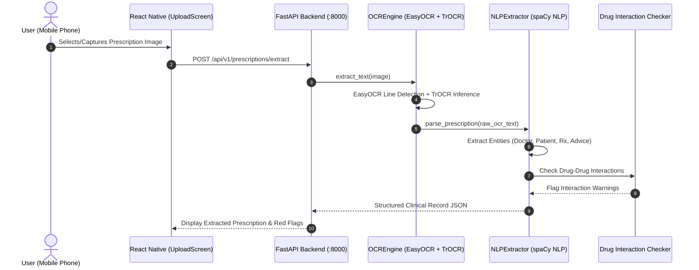

# PrescriptoAI - Medical Prescription Digitization & Clinical Extraction System

PrescriptoAI is an end-to-end mobile and AI-powered healthcare platform designed to digitize, recognize, normalize, and validate handwritten and printed doctor prescriptions into structured clinical records.

---

## 🌟 Key Features

1. **Mobile Upload & Capture:** React Native (Expo) mobile interface for capturing prescriptions via camera or gallery with real-time extraction progress.
2. **Local Vision & OCR Pipeline:** Fast bounding-box detection using EasyOCR combined with fine-tuned TrOCR (Vision-Encoder-Decoder) for handwritten clinical recognition.
3. **Clinical Entity Extraction:** Custom spaCy Clinical NLP pipeline & regex heuristics extracting:
   - Patient Information (Name, Age, Gender, Date)
   - Doctor & Hospital Details
   - Diagnosed Diseases & Clinical Advice
   - Structured Medication (Drug Name, Dosage Form, Strength, Frequency, Duration, Instructions)
4. **Safety & Validation:**
   - Doctor Signature & Registration validation flag.
   - Drug-Drug Interaction (DDI) detection against clinical reference databases.
5. **Zero-Config LAN Connectivity:** Automated network discovery scripts to synchronize mobile Expo testing with the FastAPI backend.

---

## 🏗️ System Architecture



---

## 📁 Repository Structure

```text
├── backend/                  # FastAPI REST API & Processing Pipeline
│   ├── app/                  # Application code (API routes, services, OCR, NLP)
│   ├── data/                 # Drug interaction reference datasets
│   ├── main.py               # FastAPI entry point
│   ├── requirements.txt      # Python dependencies
│   └── .env.example          # Backend environment variables template
├── frontend/                 # React Native / Expo Mobile Application
│   ├── src/                  # App components, screens, services, theme
│   ├── App.js                # App entry point
│   ├── package.json          # Node dependencies
│   └── .env.example          # Frontend environment variables template
├── ml_development/           # ML training scripts & model experimentation
├── research/                 # Synthetic data generation and research scripts
├── stitch_prescriptoai_interface_design/ # UI/UX design mockups & screens
└── docs/                     # Project documentation
```

---

## 🚀 Getting Started

### 1. Prerequisites
- **Python 3.10+**
- **Node.js 18+** & npm
- **Git**

### 2. Backend Setup
```bash
cd backend
python -m venv venv
# On Windows:
.\venv\Scripts\activate
# On Linux/macOS:
source venv/bin/activate

pip install -r requirements.txt
cp .env.example .env
# Edit .env with your credentials if needed
python main.py
```

### 3. Frontend Setup
```bash
cd frontend
npm install
cp .env.example .env
# Set EXPO_PUBLIC_API_URL to your backend host / IP
npx expo start
```

---

## 🔒 Security & Privacy Notice
Model weights (`*.safetensors`, `*.pt`, `checkpoints`) and local database files are excluded from this repository due to file size limits and security practices. Download and place pre-trained weights in their designated directories as specified in `ml_development/`.
