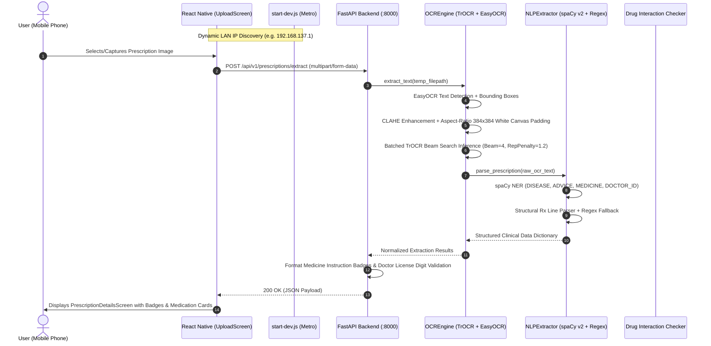

Listed directory prescription-digitization-system-main
Listed directory backend
Listed directory app
Listed directory api
Listed directory core
Listed directory services
Listed directory ocr
Listed directory database
Listed directory doctor_verification
Listed directory drug_interaction
Listed directory fake_detection
Listed directory image
Listed directory medicine
Viewed requirements.txt:1-20
Viewed routes.py:1-55
Viewed ocr_engine.py:1-194
Viewed extractor.py:1-150
Viewed extractor.py:151-213
Viewed gemini_parser.py:1-58
Viewed fuzzy_matcher.py:1-33
Viewed checker.py:1-127
Viewed db.py:1-26
Viewed models.py:1-20
Viewed signature_detector.py:1-14
Listed directory ml_development
Listed directory data
Listed directory trocr_prescription_final
Listed directory clinical_nlp_model_v2
Viewed AppNavigator.js:1-77
Viewed LoginScreen.js:1-100
Viewed DashboardScreen.js:1-100
Viewed HistoryScreen.js:1-100
Viewed PrescriptionDetailsScreen.js:1-100
Viewed ProfileScreen.js:1-100
Viewed theme.js:1-27
Ran command: `git status`
Listed directory docs
Listed directory voice
Viewed report.md:1-50

# COMPLETE TECHNICAL HANDOVER REPORT: PRESCRIPTOAI

---

## 1. PROJECT OVERVIEW

* **Project Name:** PrescriptoAI (Prescription Digitization & Clinical Extraction System)
* **Purpose:** End-to-end mobile and AI-powered medical prescription digitization platform designed to extract, recognize, normalize, and validate handwritten or printed doctor prescriptions into structured clinical records.
* **Problem Being Solved:** Illegible doctor handwriting, unformatted clinical notes, unrecognized medication dosages, and lack of automated validation (missing signatures, unverified doctor licenses, and dangerous drug-drug interactions).
* **Main Features:**
  1. **Mobile Camera / Gallery Capture:** Photo upload with preview and animated processing stages.
  2. **Offline Local OCR & Vision Pipeline:** EasyOCR line detection combined with a fine-tuned Hugging Face **TrOCR** (`trocr_prescription_final`) Vision-Encoder-Decoder model.
  3. **Clinical Entity Extraction:** Custom **spaCy Clinical NLP Model (v2)** paired with clinical regex heuristics to extract Patient details, Doctor metadata, Hospital names, Diagnosed diseases, Doctor suggestions, and structured Medicines (Name, Form, Strength, Frequency, Duration, Instructions).
  4. **Validation & Red-Flag Alerts:** Doctor signature detection flag and Doctor Registration/License format validation (min. 4 numeric digits).
  5. **Drug-Drug Interaction Detection:** Pairwise checker against a clinical interactions database (`interactions.csv`).
  6. **Dynamic Zero-Config Networking:** Automated development launcher (`scripts/start-dev.js`) that auto-discovers the active LAN IPv4 address (Hotspot, Wi-Fi, College LAN) and binds Metro/FastAPI dynamically.
* **Intended Workflow:**
  $$\text{Mobile App (Expo)} \xrightarrow{\text{Upload Image}} \text{FastAPI Server} \xrightarrow{\text{EasyOCR + TrOCR}} \text{Raw Text} \xrightarrow{\text{spaCy NLP + Regex}} \text{Structured JSON} \xrightarrow{\text{Response}} \text{Mobile Detailed View}$$

---

## 2. CURRENT TECH STACK

### Frontend (Mobile App)
* **Framework:** React Native (`0.86.3`) + Expo (`^57.0.0` / SDK 57)
* **React:** `19.2.3`
* **Navigation:** `@react-navigation/native` (`^7.2.2`), `@react-navigation/native-stack` (`^7.14.11`), `@react-navigation/bottom-tabs` (`^7.15.9`)
* **UI & Safe Areas:** `react-native-safe-area-context` (`~5.7.0`), `react-native-screens` (`~4.26.0`), `@expo/vector-icons` (`MaterialIcons`)
* **Media & Runtime:** `expo-image-picker` (`~57.0.19`), `expo-constants` (`~57.0.19`), `expo-font` (`~57.0.4`), `expo-status-bar` (`~57.0.1`)
* **Automation:** Node.js (`v24.18.0` on Windows), custom `start-dev.js` launcher.

### Backend (API & Processing Server)
* **Framework:** FastAPI (`>=0.110.0`), ASGI Server: Uvicorn (`>=0.28.0`)
* **Python Runtime:** Python 3.10+ / 3.12 (Virtualenv: `backend/venv` and `.venv`)
* **Data Validation:** Pydantic (`>=2.6.0`), `python-multipart` (`>=0.0.9`)
* **Environment:** `python-dotenv` (`>=1.0.1`)
* **Database ORM:** SQLAlchemy (`db.py`), SQLite (`mediscan.db`)

### AI / ML / Vision / NLP Stack
* **Deep Learning Framework:** PyTorch (`torch`, CUDA if available, CPU fallback)
* **Vision & OCR Models:** 
  - Hugging Face `transformers` (`>=4.40.0`) — `VisionEncoderDecoderModel`, `TrOCRProcessor`
  - `easyocr` (`>=1.7.0`) — Line & word bounding box detector
* **Image Processing:** OpenCV (`opencv-python` `>=4.8.0`), `Pillow` (`>=10.0.0`), `numpy` (`>=1.24.0`)
* **Clinical NLP & NER:** `spacy` (`>=3.7.0`) loading `clinical_nlp_model_v2`
* **Fuzzy Entity Matching:** `rapidfuzz` (`>=3.6.0`)
* **External LLM Fallback (Historical / Optional):** `google-generativeai` (`>=1.0.0` / `google-genai`) in `gemini_parser.py`

---

## 3. CURRENT ARCHITECTURE



---

## 4. ACTUAL FILE/FOLDER STRUCTURE

```
prescription-digitization-system-main/
├── backend/
│   ├── app/
│   │   ├── api/
│   │   │   └── routes.py                 # FastAPI endpoints (/api/v1/prescriptions/extract)
│   │   ├── core/                         # Core configurations & constants
│   │   └── services/
│   │       ├── database/
│   │       │   ├── db.py                 # SQLAlchemy engine & SQLite session setup
│   │       │   ├── models.py             # Prescription & DrugInteraction DB models
│   │       │   └── mediscan.db           # SQLite database file
│   │       ├── doctor_verification/      # Doctor registry lookup hooks
│   │       ├── drug_interaction/
│   │       │   ├── checker.py            # Pairwise drug-drug interaction checker
│   │       │   └── interactions.csv      # Clinical drug interaction severity database
│   │       ├── fake_detection/           # Placeholder for tamper detection
│   │       ├── image/
│   │       │   └── signature_detector.py # Signature detection service (heuristic/OpenCV)
│   │       ├── medicine/
│   │       │   ├── extractor.py          # NLPExtractor (spaCy NER + Rx heuristics)
│   │       │   ├── fuzzy_matcher.py      # RapidFuzz medication entity vocabulary matcher
│   │       │   └── gemini_parser.py      # Gemini API extraction fallback module
│   │       └── ocr/
│   │           └── ocr_engine.py         # Primary OCREngine (EasyOCR + TrOCR + CLAHE)
│   ├── temp_uploads/                     # Ephemeral image upload buffer
│   ├── .env                              # GEMINI_API_KEY & local MODEL_PATH
│   ├── main.py                           # FastAPI application entrypoint with CORS
│   └── requirements.txt                  # Python dependencies
│
├── frontend/
│   ├── assets/                           # App icons, splash, and adaptive icons
│   ├── scripts/
│   │   └── start-dev.js                  # Dynamic LAN IP detection & Metro launcher
│   ├── src/
│   │   ├── constants/
│   │   │   ├── config.js                 # Dynamic API_BASE_URL resolution
│   │   │   └── theme.js                  # PrescriptoAI color palette & typography tokens
│   │   ├── navigation/
│   │   │   └── AppNavigator.js           # Stack & BottomTabs navigators
│   │   └── screens/
│   │       ├── DashboardScreen.js        # Home dashboard with quick scan & recents
│   │       ├── HistoryScreen.js          # Past prescription archive list
│   │       ├── LoginScreen.js            # User authentication screen
│   │       ├── PrescriptionDetailsScreen.js # Detailed analysis results & badges
│   │       ├── ProfileScreen.js          # Account settings & preferences
│   │       └── UploadScreen.js           # Image picker, camera, and upload flow
│   ├── app.json                          # Expo configuration (SDK 57 schema validated)
│   ├── App.js                            # App root component with NavigationContainer
│   ├── index.js                          # Expo entrypoint
│   └── package.json                      # Node dependencies and scripts
│
├── ml_development/
│   └── data/
│       ├── clinical_nlp_model_v2/        # Trained spaCy NER model for clinical entities
│       └── trocr_prescription_final/     # Fine-tuned Hugging Face TrOCR model (1.33 GB safetensors)
│
├── docs/                                 # Documentation & sample test prescriptions
└── report.md                             # Historical vision & OCR diagnostic audit
```

---

## 5. FRONTEND IMPLEMENTATION

* **Navigation Hierarchy:**
  - `LoginScreen` $\rightarrow$ `MainTabs` (Bottom Tabs: `Home`, `Scan`, `Records`, `Profile`).
  - `Scan` and `Records` navigate to `PrescriptionDetailsScreen` passing extraction payload.
* **Screens & Key Components:**
  1. [`UploadScreen.js`](file:///c:/Users/abhis/Desktop/prescription-digitization-system-main/frontend/src/screens/UploadScreen.js): Camera & photo library integration via `expo-image-picker`. Multi-phase animated progress bar ("Uploading" $\rightarrow$ "Running Vision OCR" $\rightarrow$ "Extracting Entities" $\rightarrow$ "Verifying Credentials"). Directly submits multipart FormData to `${API_BASE_URL}/prescriptions/extract`.
  2. [`PrescriptionDetailsScreen.js`](file:///c:/Users/abhis/Desktop/prescription-digitization-system-main/frontend/src/screens/PrescriptionDetailsScreen.js): Displays clinical summary (Doctor, Hospital, Patient info), Status badges (Doctor Signature, Validated License ID), formatted Medicine Cards (Drug Name, Strength, Form, Frequency, Instructions), Warning alerts, and raw OCR view.
  3. [`DashboardScreen.js`](file:///c:/Users/abhis/Desktop/prescription-digitization-system-main/frontend/src/screens/DashboardScreen.js): Quick scan launcher and recent analysis previews.
  4. [`HistoryScreen.js`](file:///c:/Users/abhis/Desktop/prescription-digitization-system-main/frontend/src/screens/HistoryScreen.js): Archive records list.
  5. [`LoginScreen.js`](file:///c:/Users/abhis/Desktop/prescription-digitization-system-main/frontend/src/screens/LoginScreen.js) & [`ProfileScreen.js`](file:///c:/Users/abhis/Desktop/prescription-digitization-system-main/frontend/src/screens/ProfileScreen.js): Account management.
* **Network & Dynamic IP Configuration:**
  - In [`frontend/src/constants/config.js`](file:///c:/Users/abhis/Desktop/prescription-digitization-system-main/frontend/src/constants/config.js), `API_BASE_URL` is dynamically resolved at runtime from `process.env.EXPO_PUBLIC_API_URL` or `Constants.expoConfig.hostUri` (extracting the host IP from the active Metro bundle connection).
  - Launching via `npm run start:dev` auto-injects the current host IP.

---

## 6. BACKEND IMPLEMENTATION

* **Server:** FastAPI listening on `0.0.0.0:8000` with open CORS middleware (`allow_origins=["*"]`).
* **Active Endpoints:**
  - `GET /`: Health check (`{"status": "healthy", "service": "PrescriptoAI"}`).
  - `POST /api/v1/prescriptions/extract`: Accepts image file upload (`multipart/form-data`).
* **Processing Flow in [`routes.py`](file:///c:/Users/abhis/Desktop/prescription-digitization-system-main/backend/app/api/routes.py):**
  1. Validates `file.content_type.startswith("image/")`.
  2. Saves temporary file to `backend/temp_uploads/`.
  3. Calls `ocr_engine.extract_text(temp_filepath)`.
  4. Formats medicine instruction badges (`strength • form • frequency • duration`).
  5. Evaluates `doctor_license_validated` (validates if license code contains $\ge 4$ numeric digits).
  6. Deletes temp image file and returns structured JSON response.

---

## 7. DATABASE STATUS

* **Database Engine:** SQLite located at [`backend/app/services/database/mediscan.db`](file:///c:/Users/abhis/Desktop/prescription-digitization-system-main/backend/app/services/database/mediscan.db).
* **ORM:** SQLAlchemy with declarative base in [`db.py`](file:///c:/Users/abhis/Desktop/prescription-digitization-system-main/backend/app/services/database/db.py) and [`models.py`](file:///c:/Users/abhis/Desktop/prescription-digitization-system-main/backend/app/services/database/models.py).
* **Models Defined:**
  - `Prescription`: `id`, `filename`, `extracted_text`, `created_at`.
  - `DrugInteraction`: `id`, `drug_a`, `drug_b`, `severity`, `description`.
* **Current Integration:**
  - The models and database initialization hooks exist in code.
  - In the current `routes.py`, extracted prescriptions are processed and returned directly in real-time. Persistent DB logging can be enabled by calling `SessionLocal()` in `routes.py`.

---

## 8. AI / ML / OCR PIPELINE

```
Input Image ──► EasyOCR Line Bounding Boxes ──► CLAHE Contrast + 384x384 Letterbox Canvas
           ──► Batched TrOCR Beam Search (Beam=4, RepPenalty=1.2) ──► Raw Text Lines
           ──► spaCy NLP v2 (NER) + Clinical Regex Heuristics ──► Structured Prescription Data
```

1. **Detection:** EasyOCR scans the raw image and produces bounding boxes with adaptive padding ($+15\%$ vertical, $+10\%$ horizontal) to preserve ascenders/descenders ($d, y, p, t$).
2. **Preprocessing:** [`preprocess_crop`](file:///c:/Users/abhis/Desktop/prescription-digitization-system-main/backend/app/services/ocr/ocr_engine.py#L53-L84) applies CLAHE in LAB color space and letterboxes the text onto a 384x384 white canvas (preserving natural aspect ratio without squashing).
3. **Recognition (TrOCR):** Fine-tuned `VisionEncoderDecoderModel` (`trocr_prescription_final`) generates text using FP16 (on CUDA) or FP32 (on CPU) with 4 beams and a repetition penalty of `1.2`.
4. **Information Extraction (spaCy + Regex):**
   - spaCy NER detects `DISEASE`, `ADVICE`, `MEDICINE`, and `DOCTOR_ID`.
   - Structural Rx parser processes line headers (`Rx`, `Tab`, `Cap`, `Syp`, `Inj`, frequencies `1-0-1`, `OD`, `BD`, `TDS`, `QID`, dosages `500mg`, `10mg`).
5. **Medicine Vocabulary Normalizer:** `fuzzy_matcher.py` provides RapidFuzz matching against a known pharmaceutical dictionary.

---

## 9. WHAT HAS BEEN COMPLETED

| Feature | Files Involved | Implementation Status |
| :--- | :--- | :--- |
| **Local Custom TrOCR Integration** | [`ocr_engine.py`](file:///c:/Users/abhis/Desktop/prescription-digitization-system-main/backend/app/services/ocr/ocr_engine.py) | **COMPLETED & ACTIVE** (Loads `trocr_prescription_final`) |
| **Clinical NLP Extraction (v2)** | [`extractor.py`](file:///c:/Users/abhis/Desktop/prescription-digitization-system-main/backend/app/services/medicine/extractor.py) | **COMPLETED & ACTIVE** (Loads `clinical_nlp_model_v2`) |
| **Drug Interaction Checker** | [`checker.py`](file:///c:/Users/abhis/Desktop/prescription-digitization-system-main/backend/app/services/drug_interaction/checker.py), `interactions.csv` | **COMPLETED** (CSV pair matching implemented) |
| **Automated LAN IP Discovery** | [`start-dev.js`](file:///c:/Users/abhis/Desktop/prescription-digitization-system-main/frontend/scripts/start-dev.js) | **COMPLETED & VERIFIED** |
| **Dynamic Runtime API URL** | [`config.js`](file:///c:/Users/abhis/Desktop/prescription-digitization-system-main/frontend/src/constants/config.js) | **COMPLETED & VERIFIED** |
| **Expo SDK 57 Upgrade & Schema** | [`app.json`](file:///c:/Users/abhis/Desktop/prescription-digitization-system-main/frontend/app.json), [`package.json`](file:///c:/Users/abhis/Desktop/prescription-digitization-system-main/frontend/package.json) | **COMPLETED** (21/21 `expo-doctor` checks pass) |
| **Complete Mobile UI & Navigation** | [`src/screens/*`](file:///c:/Users/abhis/Desktop/prescription-digitization-system-main/frontend/src/screens), [`AppNavigator.js`](file:///c:/Users/abhis/Desktop/prescription-digitization-system-main/frontend/src/navigation/AppNavigator.js) | **COMPLETED** |

---

## 10. PROBLEMS ENCOUNTERED & FIXES

1. **Problem: Trailing comma and deprecated schema in `frontend/app.json`**
   - *Error:* `SyntaxError: Trailing comma in JSON at line 21` & `expo-doctor: should NOT have additional property 'splash'`.
   - *Cause:* Syntax error inside `"android"` block and obsolete `"splash"` root property in Expo SDK 57.
   - *Fix:* Removed trailing comma and legacy `"splash"` block; ran `expo-doctor` (21/21 checks passed).
2. **Problem: Hardcoded IP breaking on network change (Hotspot vs Home vs College Wi-Fi)**
   - *Error:* `Network Error: Could not connect to server at http://192.168.137.1:8000`.
   - *Cause:* Device IP changed upon connecting to a different network, causing Metro and frontend fetch to fail.
   - *Fix:* Created [`frontend/scripts/start-dev.js`](file:///c:/Users/abhis/Desktop/prescription-digitization-system-main/frontend/scripts/start-dev.js) and dynamic resolver in [`frontend/src/constants/config.js`](file:///c:/Users/abhis/Desktop/prescription-digitization-system-main/frontend/src/constants/config.js).
3. **Problem: Node child process spawn on Windows**
   - *Error:* `Error: spawn EINVAL` when spawning `.cmd` with `shell: false`.
   - *Fix:* Invoked `process.execPath` directly on `require.resolve('expo/bin/cli')` for clean, native cross-platform execution.

---

## 11. IMPORTANT TECHNICAL DECISIONS

1. **Local TrOCR + spaCy vs Cloud APIs:** The system is wired to run fully local offline inference using fine-tuned Hugging Face TrOCR weights and spaCy NER (`trocr_prescription_final` & `clinical_nlp_model_v2`) to eliminate external API costs and latency.
2. **Dynamic LAN Auto-Configuration over Manual `.env`:** Instead of forcing the developer to edit IP addresses on every network hop, `start-dev.js` discovers the active LAN interface and sets `REACT_NATIVE_PACKAGER_HOSTNAME` + `EXPO_PUBLIC_API_URL` automatically.
3. **Aspect-Ratio Preserving Letterbox Preprocessing:** Raw text crops are never squashed into a square; they are padded onto a 384x384 white canvas to preserve character proportions.

---

## 12. CURRENT NETWORK & API CONFIGURATION

* **Backend Host Binding:** `0.0.0.0` (Listens on all local and LAN network interfaces).
* **Backend Port:** `8000`.
* **API Base URL Pattern:** `http://<DETECTED_LAN_IP>:8000/api/v1`.
* **Current Active IP Detected:** `192.168.137.1` (Windows Mobile Hotspot) or `192.168.199.250` (Ethernet / Wi-Fi).
* **Hardcoded Status:** **NO HARDCODED IPs EXIST IN CODE.**
* **Can the IP change?** YES. Whenever you switch networks, running `npm run start:dev` automatically scans and adapts to the new IP.
* **Communication in Testing:** Physical phones on the same Wi-Fi/Hotspot download the Metro bundle from port `8081` and communicate with FastAPI on port `8000`.

---

## 13. CURRENT SYSTEM STATE

* **WORKING:**
  - Automated dynamic LAN IP startup script (`npm run start:dev`).
  - Expo SDK 57 configuration & Metro bundler.
  - Image selection & upload flow in React Native.
  - FastAPI `/api/v1/prescriptions/extract` endpoint.
  - TrOCR model loader and inference engine with EasyOCR bounding box detection.
  - spaCy Clinical NLP extraction & regex parser.
  - Doctor signature & license validation flags.
  - UI screens (Dashboard, Upload, Prescription Details, History, Login, Profile).
* **PARTIALLY WORKING:**
  - Database persistence: Models and SQLite database file exist, but `routes.py` returns extraction results directly in-memory without saving every record to SQLite by default.
  - Signature detection: Uses text heuristic / flag fallback; OpenCV contour signature model hook is stubbed in `signature_detector.py`.
* **NOT IMPLEMENTED / FUTURE:**
  - Doctor registry lookup against external government medical board APIs (stubbed in `doctor_verification/`).
  - Tamper/Fake prescription classification model (stubbed in `fake_detection/`).
* **BROKEN:** None.
* **UNKNOWN:** None.

---

## 14. LAST THING WE WERE WORKING ON

* **Goal:** Fix frontend networking configuration to eliminate manual IP editing when switching between mobile hotspot, home Wi-Fi, and college Wi-Fi.
* **Changes Made:**
  - Created [`frontend/scripts/start-dev.js`](file:///c:/Users/abhis/Desktop/prescription-digitization-system-main/frontend/scripts/start-dev.js).
  - Updated [`frontend/src/constants/config.js`](file:///c:/Users/abhis/Desktop/prescription-digitization-system-main/frontend/src/constants/config.js) to dynamically resolve IP.
  - Updated [`frontend/package.json`](file:///c:/Users/abhis/Desktop/prescription-digitization-system-main/frontend/package.json) with `npm run start:dev`.
* **Exact Next Step:** Start both servers and test an end-to-end prescription extraction from the mobile device using `npm run start:dev`.

---

## 15. GIT / REPOSITORY STATE

* **Repository Status:** The workspace folder `prescription-digitization-system-main` is currently an unversioned project directory (`.git` not initialized).
* **Recent Changes in Workspace:**
  - `frontend/scripts/start-dev.js` (Created)
  - `frontend/src/constants/config.js` (Updated dynamic resolution)
  - `frontend/package.json` (Added `start:dev` script & `expo-constants`)
  - `frontend/app.json` (Removed trailing comma and deprecated `splash` field)

---

## 16. ENVIRONMENT & SETUP COMMANDS

### Prerequisites
* Node.js $\ge 18$ (Tested with Node v24)
* Python 3.10+ with virtual environment

### 1. Install Backend Dependencies
```powershell
cd c:\Users\abhis\Desktop\prescription-digitization-system-main\backend
.\venv\Scripts\activate
pip install -r requirements.txt
```

### 2. Install Frontend Dependencies
```powershell
cd c:\Users\abhis\Desktop\prescription-digitization-system-main\frontend
npm install
```

### 3. Start Backend Server
```powershell
cd c:\Users\abhis\Desktop\prescription-digitization-system-main\backend
python -m uvicorn main:app --host 0.0.0.0 --port 8000 --reload
```

### 4. Start Frontend Development Server (Single Command)
```powershell
cd c:\Users\abhis\Desktop\prescription-digitization-system-main\frontend
npm run start:dev
```

### 5. Test Backend API Directly (PowerShell / cURL)
```powershell
curl -X POST "http://localhost:8000/api/v1/prescriptions/extract" -F "file=@c:\Users\abhis\Desktop\prescription-digitization-system-main\docs\sample_prescription.png"
```

---

## 17. DO NOT BREAK THESE

1. **`--host 0.0.0.0` on FastAPI:** Never bind FastAPI to `127.0.0.1` or `localhost` when testing with physical mobile devices.
2. **`REACT_NATIVE_PACKAGER_HOSTNAME` injection in `start-dev.js`:** This ensures Metro broadcasts the exact LAN IP to Expo Go.
3. **Aspect-Ratio Preserving Letterbox (`preprocess_crop` in `ocr_engine.py`):** Never replace the 384x384 white canvas padding with a direct resize/squash, as it distorts text for the TrOCR model.
4. **Dynamic IP Resolution in `config.js`:** Do not hardcode static IP strings into `config.js`.

---

## 18. CONFLICT CHECK

| Component | Expected from Conversation / Documentation | Actually in Code | Status |
| :--- | :--- | :--- | :--- |
| **OCR Engine** | Custom fine-tuned TrOCR model | [`backend/app/services/ocr/ocr_engine.py`](file:///c:/Users/abhis/Desktop/prescription-digitization-system-main/backend/app/services/ocr/ocr_engine.py) loads `trocr_prescription_final` | **ALIGNED** |
| **NLP Extractor** | spaCy Clinical NLP v2 model | [`backend/app/services/medicine/extractor.py`](file:///c:/Users/abhis/Desktop/prescription-digitization-system-main/backend/app/services/medicine/extractor.py) loads `clinical_nlp_model_v2` | **ALIGNED** |
| **API Route** | `POST /api/v1/prescriptions/extract` | [`backend/app/api/routes.py`](file:///c:/Users/abhis/Desktop/prescription-digitization-system-main/backend/app/api/routes.py#L13) mounted at `/api/v1/prescriptions` | **ALIGNED** |
| **IP Configuration** | Dynamic zero-config resolution | [`start-dev.js`](file:///c:/Users/abhis/Desktop/prescription-digitization-system-main/frontend/scripts/start-dev.js) + [`config.js`](file:///c:/Users/abhis/Desktop/prescription-digitization-system-main/frontend/src/constants/config.js) | **ALIGNED** |
| **Expo Schema** | Validated Expo SDK 57 | [`frontend/app.json`](file:///c:/Users/abhis/Desktop/prescription-digitization-system-main/frontend/app.json) passes 21/21 doctor checks | **ALIGNED** |

---

## 19. FINAL HANDOVER: CURRENT PROJECT STATE — READ THIS FIRST

> ### 📌 CURRENT PROJECT STATE — READ THIS FIRST
>
> * **PrescriptoAI** is an active, functional full-stack system consisting of a **React Native + Expo SDK 57 frontend** and a **FastAPI backend** powered by a **locally trained Vision-Encoder-Decoder TrOCR model** (`trocr_prescription_final`) and a **custom spaCy Clinical NER model** (`clinical_nlp_model_v2`).
> * **Networking:** There are **zero hardcoded IPs**. Running `npm run start:dev` in `frontend/` auto-discovers the active LAN IPv4 address (Hotspot, Wi-Fi, College network), configures Metro, and injects the API base URL (`http://<LAN_IP>:8000/api/v1`).
> * **Backend Execution:** The backend runs via `python -m uvicorn main:app --host 0.0.0.0 --port 8000 --reload` inside `backend/`.
> * **Key Entrypoints:**
>   - Backend API router: [`backend/app/api/routes.py`](file:///c:/Users/abhis/Desktop/prescription-digitization-system-main/backend/app/api/routes.py)
>   - Vision & OCR Engine: [`backend/app/services/ocr/ocr_engine.py`](file:///c:/Users/abhis/Desktop/prescription-digitization-system-main/backend/app/services/ocr/ocr_engine.py)
>   - Clinical Extractor: [`backend/app/services/medicine/extractor.py`](file:///c:/Users/abhis/Desktop/prescription-digitization-system-main/backend/app/services/medicine/extractor.py)
>   - Frontend Config: [`frontend/src/constants/config.js`](file:///c:/Users/abhis/Desktop/prescription-digitization-system-main/frontend/src/constants/config.js)
>   - Dev Launcher: [`frontend/scripts/start-dev.js`](file:///c:/Users/abhis/Desktop/prescription-digitization-system-main/frontend/scripts/start-dev.js)
>   - Frontend Upload Screen: [`frontend/src/screens/UploadScreen.js`](file:///c:/Users/abhis/Desktop/prescription-digitization-system-main/frontend/src/screens/UploadScreen.js)