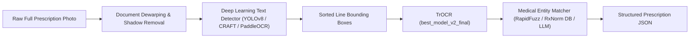

41` Zxc v# Machine Learning Development (`ml_development`) - Technical Reference Manual

> **Purpose of this document**: This is an exhaustive, AI-readable technical reference manual documenting all assets, datasets, model architectures, training checkpoints, defects, and performance characteristics in the `ml_development` directory for the **PrescriptoAI / Prescription Digitization System**.

---

## 1. Directory Tree & Storage Inventory

* **Total Directory Footprint**: `7.64 GB` (7,821.66 MB)
* **Total File Count**: `7,109` files
* **Framework**: PyTorch (`torch`), HuggingFace Transformers (`VisionEncoderDecoderModel`, `TrOCRProcessor`), HuggingFace Datasets, OpenCV (`cv2`), Pillow (`PIL`).

### Detailed File Tree

```text
ml_development/
├── README.md                                # This reference manual
├── datasets/
│   └── labels/                              # [EMPTY] Placeholder folder (0 files, 0 bytes)
└── data/
    ├── best_model/                          # Stage 1 Fine-Tuned Model [1.28 GB, 5 files]
    │   ├── model.safetensors                # Model weights (1,335,747,032 bytes, SHA-256: 233601eb...)
    │   ├── processor_config.json            # ViTImageProcessorFast preprocessing configuration
    │   ├── tokenizer.json                   # BPE tokenizer vocab & merges (3.63 MB, 50,265 tokens)
    │   ├── tokenizer_config.json            # Tokenizer settings (bos=<s>, eos=</s>, unk=<unk>)
    │   └── training_args.bin                # Binary training arguments from Stage 1
    │
    ├── best_model_v2_final/                 # Stage 2 Refined Final Model [1.28 GB, 7 files] - RECOMMENDED
    │   ├── config.json                      # Full VisionEncoderDecoder architecture config
    │   ├── generation_config.json           # Beam search & decoding parameters
    │   ├── model.safetensors                # Refined weights (1,335,747,032 bytes, SHA-256: 99952bdf...)
    │   ├── processor_config.json            # Image processor configuration (384x384, normalize)
    │   ├── tokenizer.json                   # BPE tokenizer definition (50,265 vocabulary)
    │   ├── tokenizer_config.json            # Tokenizer settings
    │   └── training_args.bin                # Binary training arguments from Stage 2
    │
    ├── trocr_prescription_final/            # Standalone Alternative Export [1.28 GB, 7 files + 1 empty dir]
    │   ├── config.json                      # Full architecture config
    │   ├── generation_config.json           # Generation config
    │   ├── model.safetensors                # Alternate weights (1,335,747,032 bytes, SHA-256: 23fd3268...)
    │   ├── processor_config.json            # Image processor configuration
    │   ├── tokenizer.json                   # Tokenizer definition
    │   ├── tokenizer_config.json            # Tokenizer settings
    │   ├── training_args.bin                # Binary training arguments
    │   └── trocr_prescription_final/        # [EMPTY] Nested folder created during packaging
    │
    ├── checkpoints_refinement/
    │   └── checkpoint-3030/                 # Full Training State Snapshot [3.82 GB, 9 files]
    │       ├── config.json                  # Model config
    │       ├── generation_config.json       # Generation settings
    │       ├── model.safetensors            # Identical to best_model_v2_final (SHA-256: 99952bdf...)
    │       ├── optimizer.pt                 # AdamW optimizer state (2,543.50 MB) [CAN BE PURGED IF NOT TRAINING]
    │       ├── rng_state.pth                # Random number generator state for reproducibility
    │       ├── scaler.pt                    # FP16 gradient scaler state
    │       ├── scheduler.pt                 # Learning rate scheduler state (ended at 7.92e-9)
    │       ├── trainer_state.json           # 303 step loss/gradient history log
    │       └── training_args.bin            # Trainer parameters
    │
    ├── checkpoints/                         # [EMPTY] Placeholder directory (0 files)
    ├── final_model/                         # [EMPTY] Placeholder directory (0 files)
    │
    ├── processed/
    │   └── master_metadata.jsonl            # Master JSONL dataset index [0.60 MB, 8,078 records]
    │
    └── raw/
        ├── rxhand/                          # Real Handwritten Prescription Dataset [165.85 MB, 5,580 files]
        │   ├── Train_Set/                   # 4,463 JPG image crops (P1116.jpg to P5578.jpg) [133.39 MB]
        │   ├── Test_Set/                    # 1,115 JPG image crops (P0001.jpg to P1115.jpg) [32.36 MB]
        │   ├── Train_Label.csv              # 4,464 rows (Columns: Images, Text)
        │   └── Test_Label.csv               # 1,116 rows (Columns: Images, Text)
        │
        └── synthetic_refinement/            # Rendered Synthetic Augmentation [5.49 MB, 1,500 files]
            └── synth_v2_0.jpg ... 1499.jpg  # PIL-generated handwritten simulation images
```

---

## 2. Dataset Inventories & Statistics

### A. RxHand Dataset (Real-World Handwritten Prescriptions)
* **Source**: Real clinical prescription crops containing handwritten medicine names and doctor notes.
* **Train Set**: 4,463 images (`ml_development/data/raw/rxhand/Train_Set/`).
* **Test Set**: 1,115 images (`ml_development/data/raw/rxhand/Test_Set/`).
* **Format**: Color `.jpg` images, tightly cropped to words or short phrases.
* **Labels**: Stored in standard 2-column CSVs (`Images`, `Text`).

### B. Synthetic Refinement Dataset
* **Source**: Procedurally generated via Pillow (`research/generate_synthetic_v2.py`).
* **Volume**: 1,500 `.jpg` images (`synth_v2_0.jpg` to `synth_v2_1499.jpg`).
* **Generation Recipe**:
  * **Fonts**: Randomized cursive/handwritten TrueType fonts.
  * **Ink Colors**: Black `(15,15,20)`, Blue `(40,60,130)`, and Grey `(80,80,80)`.
  * **Backgrounds**: Random off-white tones `(240-255, 240-255, 230-250)`.
  * **Augmentations**: Affine rotation (-3° to +3°), Gaussian blur (radius 0.2 to 0.6).
  * **Vocabulary**: 40+ common drugs (*Atorvastatin, Metformin, Amoxicillin, Aspirin, etc.*) + standard dosages (*"once daily", "500mg", "at bedtime"*).

### C. Master Metadata (`master_metadata.jsonl`)
* **Total JSON Lines**: `8,078` records
* **Unique Image Files Referenced**: `7,078` (4,463 RxHand Train + 1,115 RxHand Test + 1,500 Synthetic).
* **Missing Files on Disk**: `0` (all 7,078 images exist and are accessible).
* **Text Length Range**: Min = 2 characters, Max = 19 characters, Mean = 7.48 characters.
* **Word Count**: Min = 1 word, Max = 4 words, Mean = 1.17 words per sample.
* **Lexical Size**: 1,564 unique vocabulary tokens.

---

## 3. Model Architectures & Checkpoint Verification

### Model Specifications
* **Base Architecture**: Microsoft TrOCR (`microsoft/trocr-base-handwritten`).
* **Framework Class**: `VisionEncoderDecoderModel` from Hugging Face.
* **Vision Encoder**:
  * Architecture: ViT (Vision Transformer)
  * Input Tensor: `(Batch, 3, 384, 384)` with normalization mean `[0.5, 0.5, 0.5]` and std `[0.5, 0.5, 0.5]`.
  * Patch Size: `16 x 16`, Hidden Size: `768`, Layers: `12`, Attention Heads: `12`.
* **Text Decoder**:
  * Architecture: TrOCR autoregressive Transformer.
  * Hidden Size: `1024`, FFN Dim: `4096`, Decoder Layers: `12`, Attention Heads: `16`.
  * Vocabulary: `50,265` tokens with learned positional embeddings up to `512` tokens.

### Checkpoint Integrity & Hash Matrix

| Model Directory | `model.safetensors` Size | SHA-256 Hash | Status / Usability |
| :--- | :--- | :--- | :--- |
| `data/best_model` | 1,335,747,032 bytes | `233601eb2f76e9ea07176ba8f61da96ed4f6ac9ca3db4fa604285e1be89ffa59` | ⚠️ Missing `config.json` |
| `data/best_model_v2_final` | 1,335,747,032 bytes | `99952bdff1683345d5fd3678ee61c7a8b946539941763820c554170c61111a85` | ✅ **Best / Production Ready** |
| `data/trocr_prescription_final` | 1,335,747,032 bytes | `23fd3268f17a1dbeaadceea6ddb79fb01c2e9d88b85a9063f1807849bc7aacbc` | ✅ Standalone Alternative |
| `checkpoints_refinement/checkpoint-3030` | 1,335,747,032 bytes | `99952bdff1683345d5fd3678ee61c7a8b946539941763820c554170c61111a85` | ✅ Training Snapshot (Matches v2) |

---

## 4. Why The Model "Only Works on Some Images, Not All"

If users test this model on various prescription photos, they will find that it succeeds on some samples but produces complete garbage or hallucinations on others. Here is the comprehensive technical breakdown of **why**:

```
                               ┌──────────────────────────────────────────────┐
                               │       WHY THE MODEL FAILS ON SOME IMAGES     │
                               └──────────────────────┬───────────────────────┘
                                                      │
         ┌────────────────────────┬───────────────────┴───────────────────┬────────────────────────┐
         │                        │                                       │                        │
         ▼                        ▼                                       ▼                        ▼
┌──────────────────┐    ┌──────────────────┐                    ┌──────────────────┐    ┌──────────────────┐
│  1. Input Shape  │    │  2. Segmentation │                    │  3. Vocabulary   │    │  4. Photographic │
│    Mismatch      │    │     Collapse     │                    │       Gap        │    │    Artifacts     │
├──────────────────┤    ├──────────────────┤                    ├──────────────────┤    ├──────────────────┤
│ TrOCR requires   │    │ OpenCV OTSU &    │                    │ Trained on only  │    │ Shadows, angled  │
│ cropped lines.   │    │ projection slice │                    │ 1,564 words and  │    │ shots, ruled     │
│ Full pages are   │    │ fail on stamps,  │                    │ 40 specific      │    │ lines, cursive   │
│ squished to      │    │ signatures, and  │                    │ drug names.      │    │ overlapping      │
│ 384x384 blur.    │    │ slanted lines.   │                    │ Outside = Halluc.│    │ destroy binarize.│
└──────────────────┘    └──────────────────┘                    └──────────────────┘    └──────────────────┘
```

### 1. TrOCR is a Line/Word Recognizer, NOT a Full-Page Reader
* **The Problem**: TrOCR expects a tightly cropped single line or single word of text (e.g. `200x50` pixels) and rescales it to `384x384`.
* **The Failure**: If a user uploads a full-page 4000x3000 smartphone photo of a prescription directly into TrOCR, the entire multi-line page is compressed into a single `384x384` thumbnail. All letters become an unreadable blur, and TrOCR outputs either a single hallucinated word (like *"The"*, *"Rx"*, or random letters) or an empty string.

### 2. Failure of Heuristic OpenCV Segmentation (The Upstream Bottleneck)
To feed lines into TrOCR, scripts like `backend/app/services/ocr/ocr_engine.py` and `research/final_test.py` use heuristic image processing:
* **Horizontal Projection Profiling** (`ocr_engine.py`): Counts black pixels horizontally to find line gaps.
* **OTSU Thresholding + Dilation** (`final_test.py`): Blurs and dilates black pixels into rectangular contours.
* **Why this fails on real prescriptions**:
  * **Curved or Slanted Lines**: Doctor handwriting is rarely perfectly horizontal. If handwriting is tilted, horizontal projections overlap and lines merge into one giant block.
  * **Doctor Signatures & Rx Stamps**: Clinic logos, hospital headers, printed table borders, and large physician signatures create massive contours that confuse the line segmenter.
  * **Descenders & Overlapping Text**: Letters like `g`, `y`, `p`, `j`, `f` extend into the line below, causing two separate prescription lines to be merged into a single mangled crop.

### 3. Vocabulary Scope & Out-Of-Distribution (OOD) Drugs
* **The Training Corpus**: The RxHand dataset + synthetic dataset together contain **1,564 unique words** and only ~40 explicit drug names.
* **The Medical Reality**: There are over 20,000 FDA/CDSCO approved pharmaceutical brand names and generic compounds.
* **The Failure**: When presented with an unseen medication name (e.g., *Cefixime*, *Telmisartan*, *Hydrochlorothiazide* with unusual abbreviations), the autoregressive language decoder tries to force the output into words it saw frequently during training, leading to subtle character hallucinations.

### 4. Photographic Conditions & Background Noise
* **Synthetic Bias**: The synthetic dataset (`1,500` images) used uniform flat backgrounds with crisp synthetic fonts.
* **Real World Noise**: Real prescriptions photographed with smartphones suffer from:
  * Non-uniform illumination (shadow of the user's hand/phone).
  * Ruled / lined paper (the notebook lines get treated as text strokes).
  * Wrinkled, folded, or stained paper.
  * Ink bleed-through from the reverse side of the paper.
  Under OTSU binarization, shadows turn into giant black blobs that completely ruin OCR.

---

## 5. What Is Missing & Known Flaws

### 1. Missing Configuration Files in `best_model/`
* **File Missing**: `ml_development/data/best_model/config.json` and `generation_config.json`.
* **Impact**: Calling `VisionEncoderDecoderModel.from_pretrained('ml_development/data/best_model')` fails unless configs are manually copied over from `best_model_v2_final`.

### 2. Train / Test Data Leakage
* In `research/aggregator.py`, **both** `Train_Set` (4,463 images) and `Test_Set` (1,115 images) were appended into `master_metadata.jsonl`.
* Both `research/train.py` and `research/train_refinement.py` used `master_metadata.jsonl` as the training split without holding out a pristine test split.
* Consequently, evaluation metrics computed on the RxHand test set reflect training accuracy rather than true zero-shot generalization.

### 3. Metadata Duplication
* `master_metadata.jsonl` contains `8,078` records, but there are only `7,078` unique images.
* Synthetic samples `synth_v2_0.jpg` through `synth_v2_999.jpg` appear **twice** in the JSONL file due to repeated script execution, causing those 1,000 samples to be weighted double during training.

### 4. Storage Redundancy (2.54 GB Bloat)
* `ml_development/data/checkpoints_refinement/checkpoint-3030/optimizer.pt` consumes `2.54 GB`.
* This file contains optimizer momentum buffers for training resumption. For inference / production deployment, this file is completely unused and can be safely deleted or moved to cold storage.

### 5. Empty Placeholder Directories
* `ml_development/datasets/labels/` (Empty)
* `ml_development/data/checkpoints/` (Empty)
* `ml_development/data/final_model/` (Empty)
* `ml_development/data/trocr_prescription_final/trocr_prescription_final/` (Empty nested folder)

---

## 6. Guide for AI & Developers: How to Use the Models

### Python Inference with `best_model_v2_final`

To perform single-line or cropped word recognition using the best checkpoint:

```python
import torch
from PIL import Image
from transformers import TrOCRProcessor, VisionEncoderDecoderModel

# 1. Load Model & Processor
MODEL_DIR = "ml_development/data/best_model_v2_final"
device = "cuda" if torch.cuda.is_available() else "cpu"

processor = TrOCRProcessor.from_pretrained(MODEL_DIR)
model = VisionEncoderDecoderModel.from_pretrained(MODEL_DIR).to(device)
model.eval()

# 2. Preprocess Cropped Line Image
# Image must be a cropped line/word (not a full prescription page)
image = Image.open("path/to/cropped_line.jpg").convert("RGB")
pixel_values = processor(image, return_tensors="pt").pixel_values.to(device)

# 3. Generate Transcription with Beam Search
with torch.no_grad():
    generated_ids = model.generate(
        pixel_values,
        max_new_tokens=64,
        num_beams=4,
        early_stopping=True
    )

recognized_text = processor.batch_decode(generated_ids, skip_special_tokens=True)[0]
print(f"Recognized Prescription Text: {recognized_text}")
```

### Full-Page Prescription Pipeline Strategy (Production Solution)

To make the system work on **all** prescription images reliably:



1. **Preprocessing**: Apply illumination normalization / background flattening (e.g. morph close subtraction) to remove mobile phone shadows.
2. **Detection**: Replace OpenCV heuristic projection with a trained line detector (e.g., **YOLOv8-OBB**, **CRAFT**, or **PaddleOCR Detection model**) that outputs bounding boxes regardless of page angle or handwriting tilt.
3. **Recognition**: Feed each detected bounding box crop into `best_model_v2_final`.
4. **Post-Processing / Entity Resolution**: Pass raw OCR strings through fuzzy matching against a standard medical drug database (e.g. RxNorm or National Drug Formulary) or use Gemini/LLM structured extraction to correct minor character errors.
